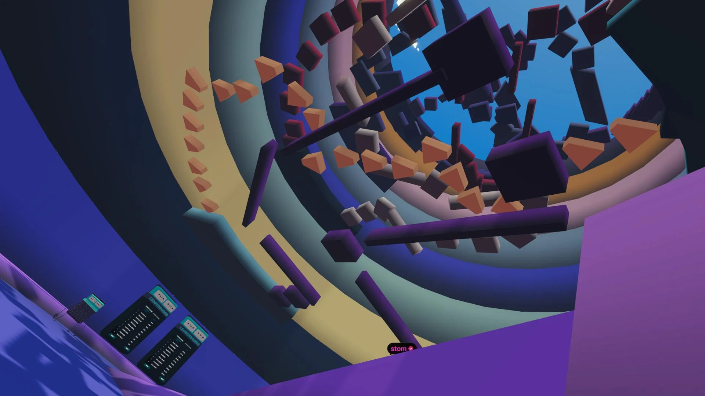

# Tower of Madness

<!-- example-context:start -->
**Maintained by:** Community · dcl-regenesislabs

[View upstream source](https://github.com/dcl-regenesislabs/towerofmadness)

This community project is maintained outside the Decentraland GitHub organization. Its source code and live deployment may change independently. Inclusion in this catalog does not imply a security audit or guarantee of safety. Review code, dependencies, and installation scripts before running or reusing it.

[Report a catalog concern](https://github.com/decentraland/docs/issues/new). For suspected vulnerabilities, follow the upstream project's security policy. Do not include exploit details or credentials in public issues.
<!-- example-context:end -->

- [Play on Decentraland](https://decentraland.org/jump?realm=towerofmadness.dcl.eth)

A timed platforming game where players race to reach the top.

### Explore the code

These links point to a specific source snapshot so the explanations remain useful as upstream development continues. They are learning references, not a security assessment.

- **Preload the pieces of a changing level.** [`setupChunkPreload`](https://github.com/dcl-regenesislabs/towerofmadness/blob/be318c6f0a287c15f3771f12f629b84de6cc18af/src/chunkPreload.ts#L22-L61) deduplicates the chunk asset paths and creates temporary GLTF entities. A system watches their loading states, removes entities after loading completes or fails, and unregisters itself when none remain. This illustrates managing a preload lifecycle; the asset list comes from `shared/chunks` and is specific to the tower.
- **Build a skippable camera tour around changing geometry.** [`playCinematic`](https://github.com/dcl-regenesislabs/towerofmadness/blob/be318c6f0a287c15f3771f12f629b84de6cc18af/src/cinematicCamera.ts#L110-L209) adjusts camera keyframes around the current start and end chunks, then selects a virtual camera. The [update system](https://github.com/dcl-regenesislabs/towerofmadness/blob/be318c6f0a287c15f3771f12f629b84de6cc18af/src/cinematicCamera.ts#L286-L334) interpolates position and look-at targets and supports holding a button to skip. Follow the chunk lookup helpers and `skipCinematic` to see how the tour finds its anchors and returns control to the player camera.

