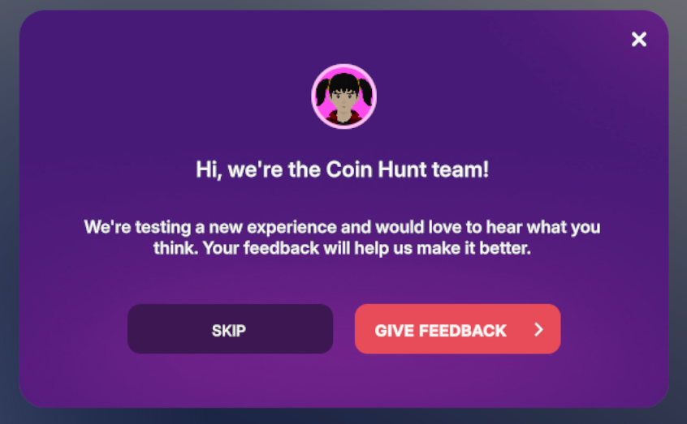
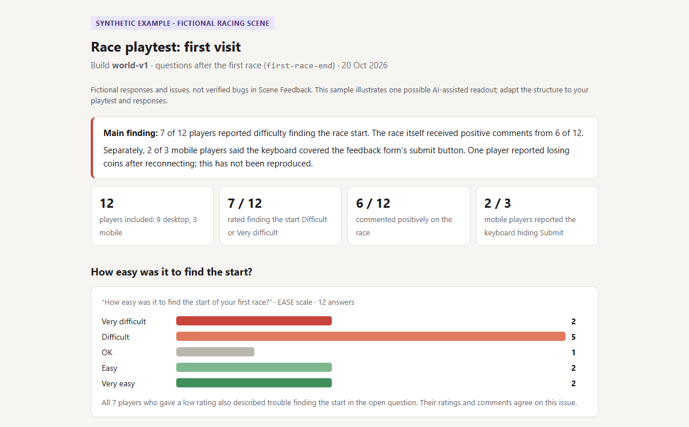

# Scene Feedback

- [Source on GitHub](https://github.com/decentraland/sdk7-test-scenes/tree/main/scenes/0,-1-scene-feedback)
- [Play shared test build (Zone)](https://decentraland.zone/jump/?dclenv=zone&realm=sdk7testscenes.dcl.eth&position=0,-1)
- [Installation and usage guide](https://github.com/decentraland/sdk7-test-scenes/blob/main/scenes/0,-1-scene-feedback/README.md)

Learn what players find confusing, frustrating or enjoyable, even when you cannot watch them play. This reusable module includes a coin-hunt scene showing how to collect feedback during play and when players choose to give it.

### Add it with an AI agent

Give your AI agent the [Scene Feedback SDK skill](https://github.com/decentraland/sdk-skills/tree/main/scene-feedback) link and ask:

> Help me add Scene Feedback to this scene. First suggest suitable questions and when to ask them, then review the plan with me before integrating it.

The skill can help at two stages:

- **Before a playtest:** adapt questions, rating scales and timing to your game, then integrate the module after you review the plan.
- **After a playtest:** use the skill again with your CSV files to identify recurring problems and preferences, review the evidence and decide what to investigate next. You can also ask for a [human-readable HTML report](#example-ai-generated-feedback-report) with grouped answers and rating summaries.

Prefer to integrate it yourself? Follow the [installation guide](https://github.com/decentraland/sdk7-test-scenes/blob/main/scenes/0,-1-scene-feedback/README.md#add-it-to-your-scene).

### How the module fits into your scene

You choose when to invite players, which questions to ask and when those questions appear in your game. The [coin-hunt demo in Zone](https://decentraland.zone/jump/?dclenv=zone&realm=sdk7testscenes.dcl.eth&position=0,-1) shows one possible setup:

1. **Collect the first coin.** An invitation asks whether the player wants to give feedback: "Hi, we're the Coin Hunt team!" If accepted, one question follows: "How easy or difficult was it to spot the coins?" The player chooses a rating and can add a comment.
2. **Finish the first round (five coins).** Players who agreed to participate receive two questions, one after another: how clear the next goal is and whether they want to keep playing.
3. **Give feedback at any time.** The **Leave feedback** button, clickable kiosk and marked area open a welcome message followed by a question set. These remain available even after declining gameplay questions.

By default, gameplay questions go only to participants. Players can join through an invitation, or your scene can use `feedback.enroll` to add selected playtesters—for example, by checking wallet addresses against your tester list or applying another selection rule. See the [selected-tester example](https://github.com/decentraland/sdk7-test-scenes/blob/main/scenes/0,-1-scene-feedback/EXAMPLES.md#4-selected-testers-without-an-intro).

<figure><figcaption>
The demo invites players to choose whether to participate.
</figcaption></figure>

<figure><figcaption>
A question with a labelled rating and an optional comment.
</figcaption></figure>

### Key features

- **Flexible questions.** Choose ready-made questions and rating scales, adapt them to your game or create your own. Use labelled ratings, optional comments or text-only answers.
- **Participation rewards.** Encourage participation with a reward that fits your game. In the demo, answering every question in one form earns a visit-only Playtest Contributor nameplate visible to you, +5 coin score and double score for the next five pickups, once per visit. Any rating counts; comments remain optional.
- **CSV results in scene Storage.** A Multiplayer Server saves each response with its question and gameplay moment. Download the files to review in a spreadsheet.

### Adapt it to your scene

Use the [integration recipes](https://github.com/decentraland/sdk7-test-scenes/blob/main/scenes/0,-1-scene-feedback/EXAMPLES.md) to connect questions to your own game events, including inviting participants now and asking after later gameplay. For playtest planning and finding players, see [Playtests](https://docs.decentraland.org/creator/scenes-sdk7/designing-the-experience/playtests).

### Example AI-generated feedback report

**The report is created by an AI agent, not by the Scene Feedback module.** Give your agent the exported CSV files and use the Scene Feedback SDK skill to analyze them and generate an HTML report.

This example uses synthetic responses from a fictional scene. Your agent can tailor the analysis and report to your own playtest questions and data.

<figure><figcaption>
Illustrative report using synthetic responses from a fictional scene.
</figcaption></figure>


Download the example report, extract the ZIP and open the HTML file in your browser.

