# Uploading Smart Wearables

After generating your Smart Wearable using the [SDK7](https://github.com/decentraland/docs/blob/main/creator/sdk7/projects/smart-wearables.md), the next step is to upload it to the builder. This document explains how to upload, publish, and put your Smart Wearables up for sale.

## Uploading Your File

Remember that you need to create a collection before uploading your file. If you don’t know how to do that, check [Creating a Collection](https://github.com/decentraland/docs/blob/main/creator/wearables-and-emotes/manage-collections/creating-a-collection.md). To upload your Smart Wearable, drag and drop the file on the _**New Item**_ window or browse your computer. It will automatically detect if the file is a Smart Wearable. **Remember that the collection max file size is 3MB**.

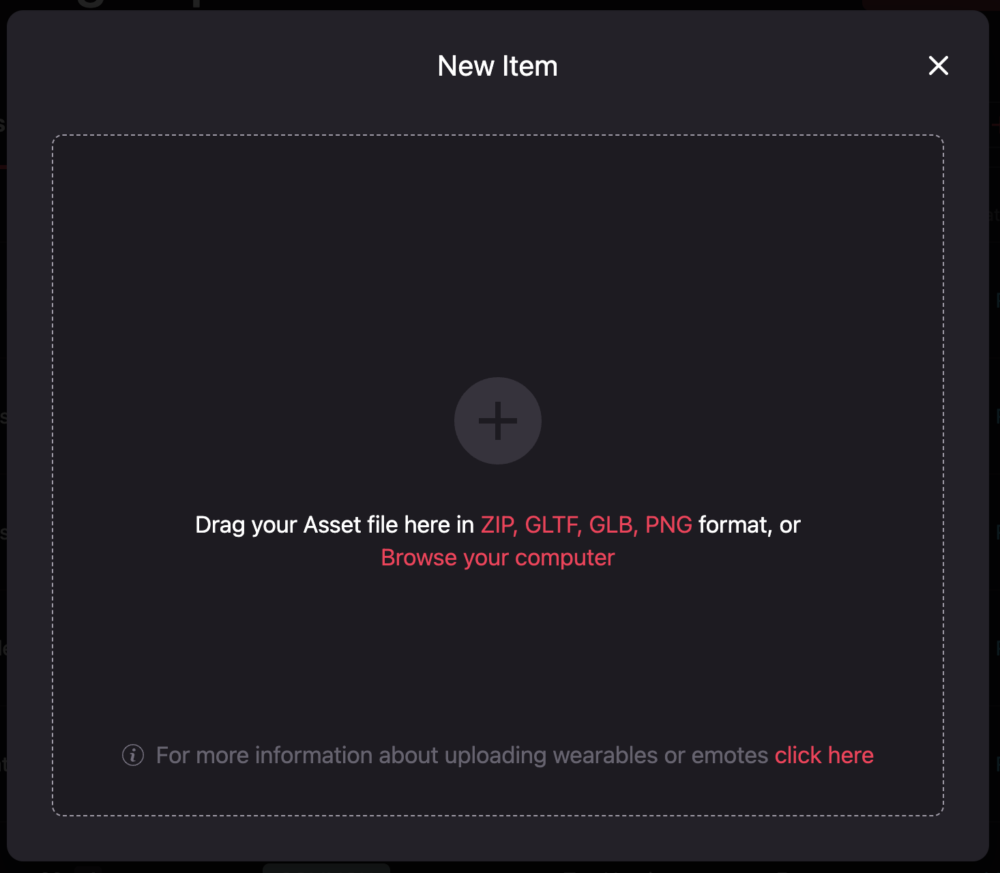

When you upload the file, you will be asked to upload a video showcase.

## Uploading Your Video Showcase

This video showcase will be displayed in the marketplace for buyers to see how the Smart Wearable works.

To upload your video showcase, drag and drop a **.mp4** video file on the _**Upload a video for your Smart Wearable**_ window or browse your computer. **Remember that the video max file size is 4MB and max duration is 15 seconds**.

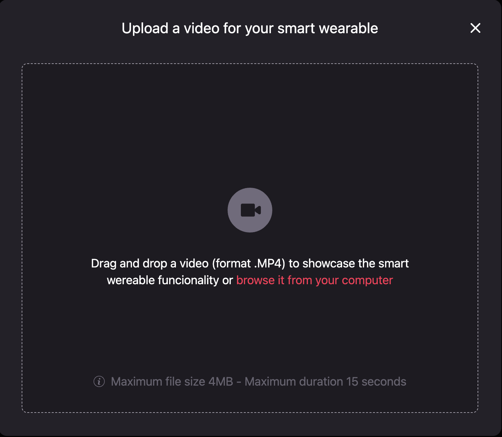

When you upload the video showcase, you will be asked to enter a name and define the rarity and the category. You can also add a thumbnail for the Smart Wearable if you like.

### Rarity

Select the Rarity of your item.

| Rarity    | Number of Items |
| --------- | --------------- |
| Unique    | 1               |
| Mythic    | 10              |
| Exotic    | 50              |
| Legendary | 100             |
| Epic      | 1,000           |
| Rare      | 5,000           |
| Uncommon  | 10,000          |
| Common    | 100,000         |

### Category

Wearables are organized into different categories, depending on what part of an avatar they modify. In this step, you must select the appropriate item category.

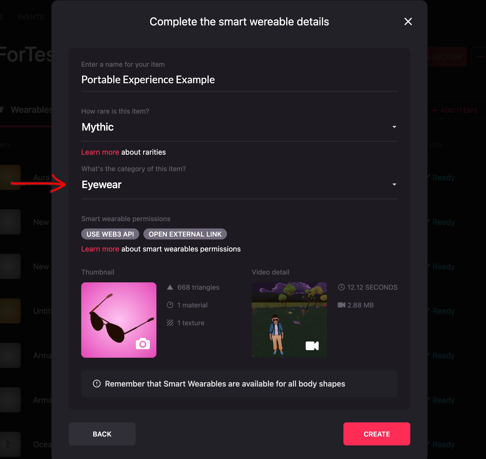

### Custom Thumbnails

You can add your thumbnail by clicking on the camera icon and selecting the image you want from your computer. **Please ensure that the thumbnail is in a 256px square .png file format, with a transparent background.** Please note that the Curation Committee will not approve collections that have thumbnails without transparent backgrounds.

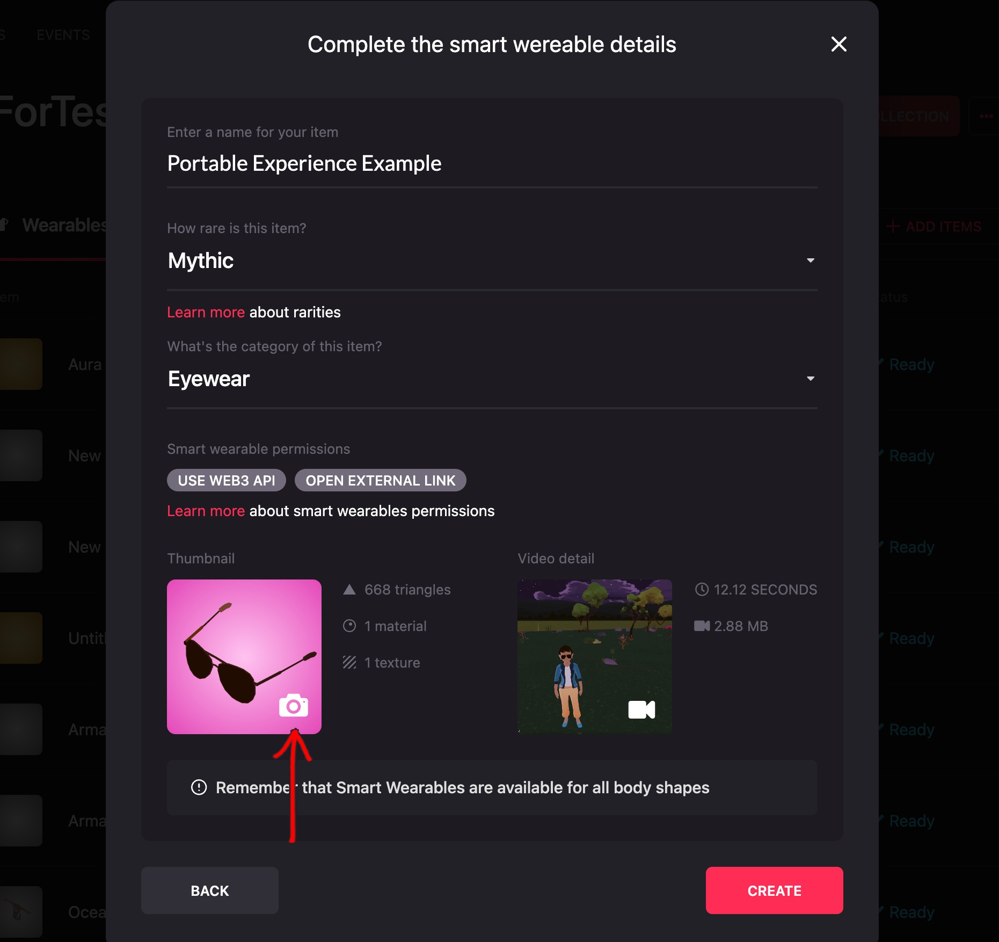


⚠️ Having a good render of your Wearable is crucial for making it more appealing to potential Marketplace users. **It's important to avoid adding graphics other than the wearable itself because this may cause the Curation Committee to reject it.**

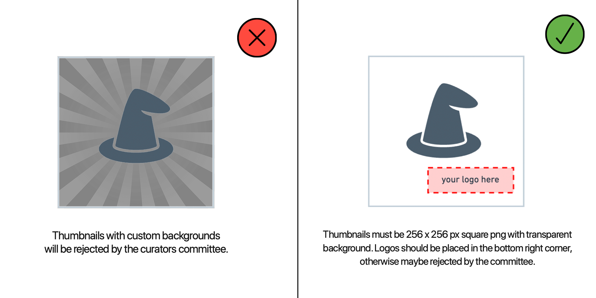


### Update Video Showcase

To update your video showcase, simply click on the camera icon and browse for the video on your computer. **Keep in mind that the maximum allowed file size is 4MB and the duration should not exceed 15 seconds**.

### Properties

Next to the thumbnail, you're going to find the properties of your wearable such as the number of triangles of your model, the number of materials, and the textures.

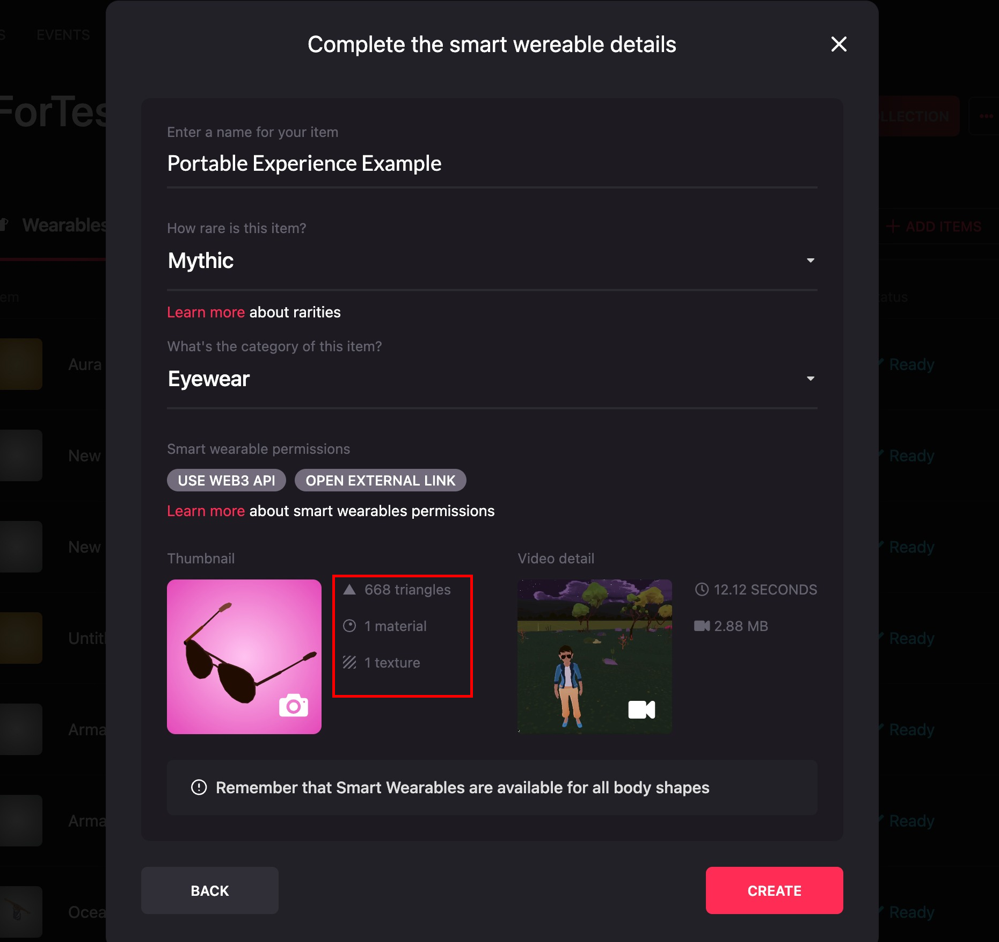

## Uploading Mouth, Eyes and Eyebrows

The mouth, eyes and eyebrows category have a different behaviour in the editor because these are just .png files. To upload these just drag and drop the png file as a transparent image (256X256 pixels). Mouth is going to be automatically tinted by skin color, same for the eyebrows tinted by the hair color.


If you want the asset to be masked, so a part of the mouth or eyebrows is not affected by the tinting, upload a zip file with both the png and the mask files. Remeber that the mask file should have a suffix "\\\_mask" in order to work.


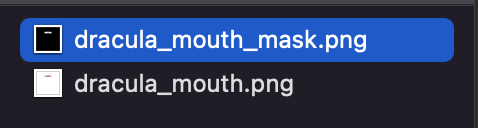

After that uploading your Wearables you will end up with a screen like this, that shows the items in your collection.

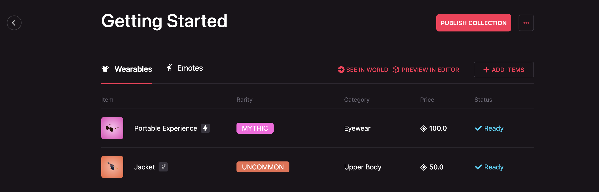

## Setting the Price of Your Smart Wearable

You can set the price of your Wearable by clicking on _**Set Price**_. This can all be edited anytime, so don’t worry if you want to change it later. Prices are set in MANA. Remember that when you mint Wearables, they are minted directly on Matic/Polygon. Indeed, when a user purchases your item, the transaction will be conducted in Matic/Polygon MANA.

You could also _**Make it Free**_, meaning the price will be 0 MANA, and the beneficiary address will be null. Please note that offering a product for free as a primary sale does not prevent it from being sold at any price as a secondary sale.

Don’t forget to set the beneficiary address, which is the one that will receive the MANA from your sales. You can use any Ethereum address you like. To automatically fill in the address you are logged in with, click _**I’m the Beneficiary.**_

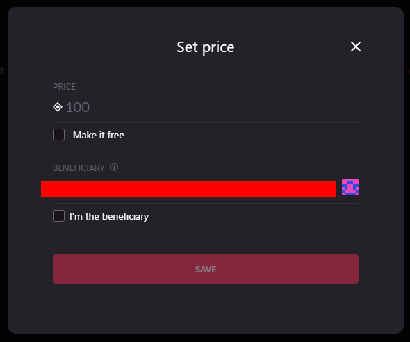

Save the price, and you will be back on the list of Wearables in your collection. When you click on the item, you will get its general info. Click on the button _**Preview in Editor**_ to see it in the editor.

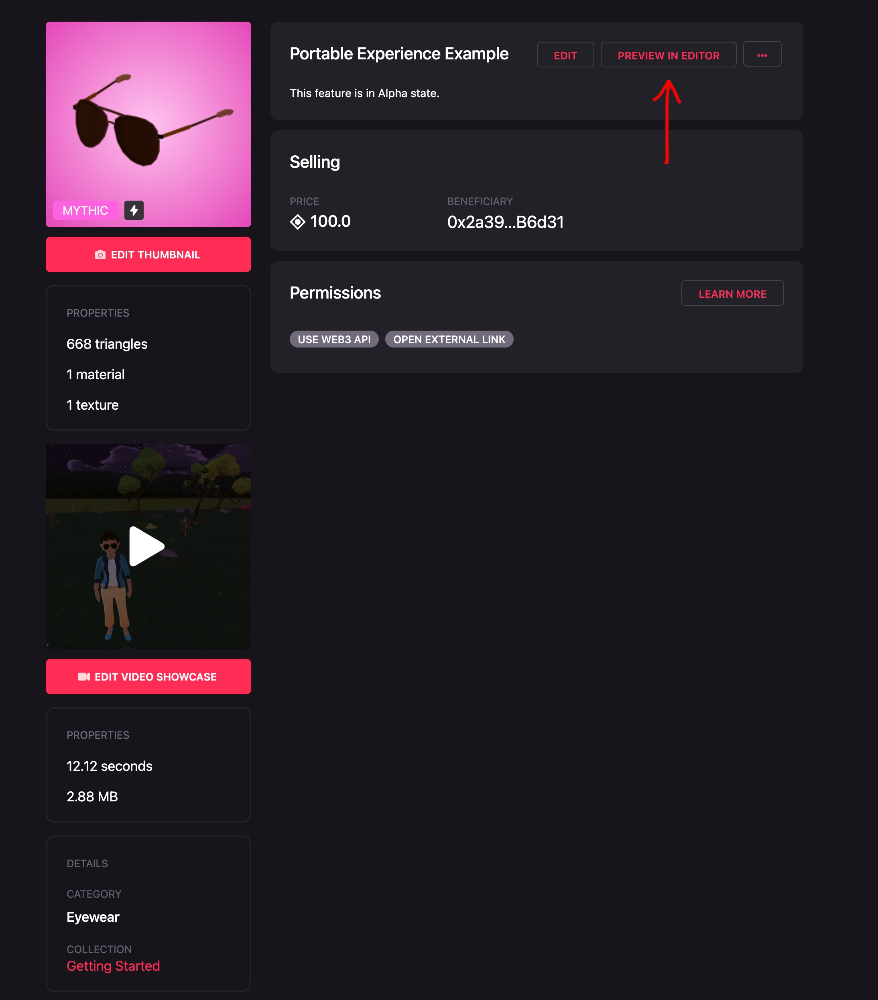

## The Editor

Once you click on _**Preview in Editor**_, you will have the editor open. You can edit your Smart Wearable info, including the description, tags and overrides.

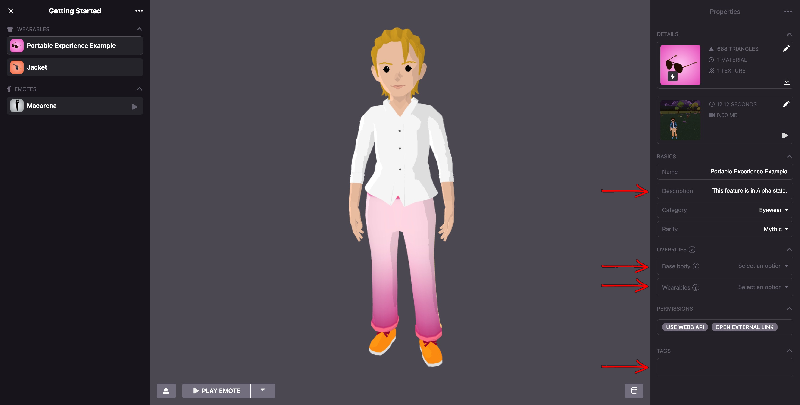

## Description

This is a brief statement describing your item that will be displayed in the marketplace.

## Overrides

Overrides determine which Wearable categories or avatar body parts your item will hide. For instance, a hat with attached hair might need to hide the _Hair_ category. A deep-sea diver helmet may require hiding head accessories like earrings, eyewear, tiaras, etc., which wouldn’t be visible. Multiple options can be selected for each override.

* **Base Body**: This refers to core avatar parts like the _head_ and _hands_. For example, if you’re creating a **Handwear** item such as a robot mechanic hand, you’ll likely need to hide _hands_ to prevent overlap and clipping.
* **Wearables**: This includes other Wearable categories. You can hide multiple categories. Please take a look at [**Creating Wearables**](https://github.com/decentraland/docs/blob/main/creator/wearables-and-emotes/wearables/creating-wearables.md) for more details on each category and how items interact.


Note: The overrides you select will be the suggested default settings for your Wearable. However, users can customize which Wearables are hidden or showing from the Backpack.


## Tags

Tags are descriptive words that users can utilize for competitions or events!

## Preview

To preview your Smart Wearable, hover your mouse over the wearable element on the top left and click on the eye symbol.

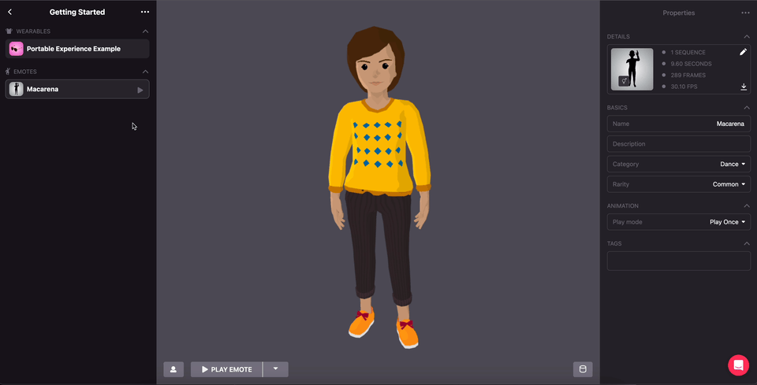

By clicking on the icon at the lower left, you can edit the avatar. This is useful if you have a male and female version of your Wearable, so check how both versions look in the editor, testing different emotes to identify skinning issues and mixing other Wearables to see how it matches with other clothes. When you’re done editing your wearable, click on _**Save**_.

## Testing in Decentraland

Even after testing the Smart Wearable in the editor, it’s important to check how it will look and behave in Decentraland. To try it there, go to the Collections tab. Select the desired collection and click the button _**See in Decentraland**_.

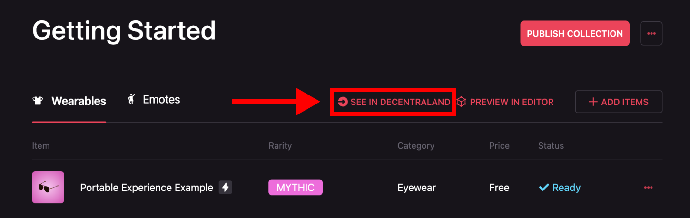

After clicking the _**See in Decentraland**_ button, the following pop-up is going to appear. Selecting _**Empty Parcels**_ will teleport you to a place without too much content, which will load faster. Selecting _**Genesis Plaza**_ will take you to the main plaza.

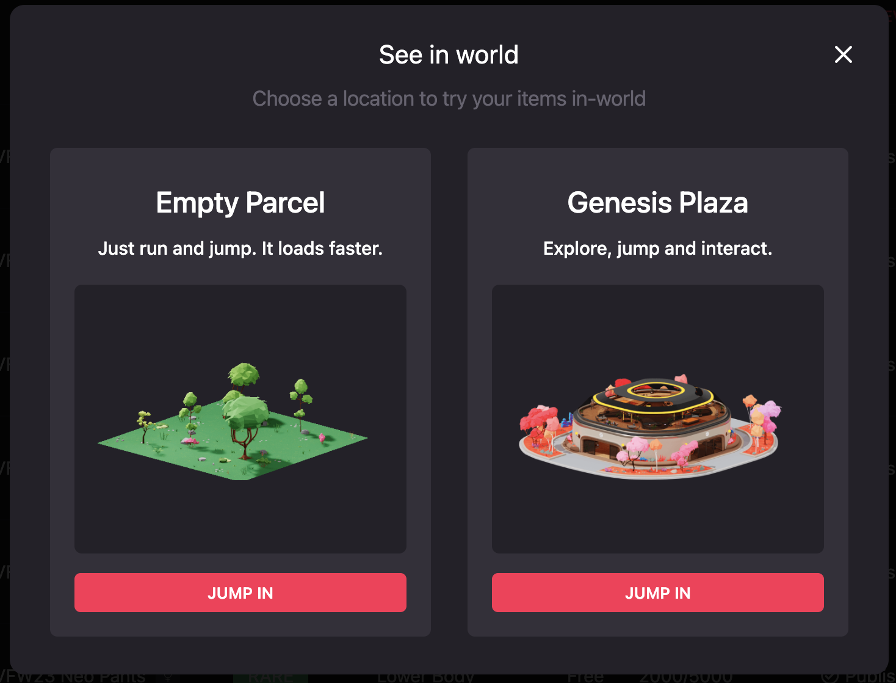

Once you select the location to teleport, a new tab will open on your browser and you will get this message.

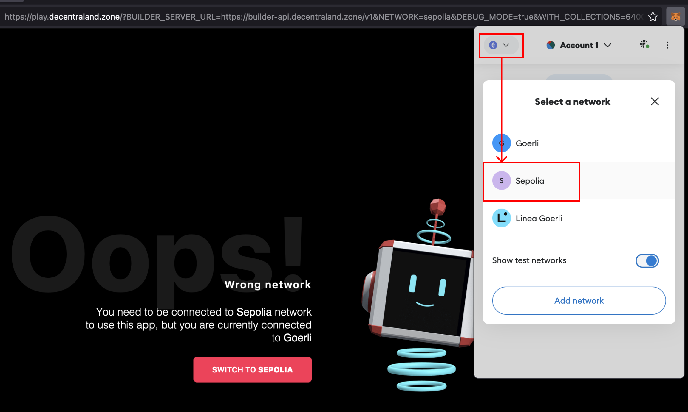

Click on _**Switch to Sepolia**_, and a pop-up from your wallet asking you to switch the network will show up. Click on Switch Network, and the new tab will automatically refresh. To test your Smart Wearable, you can go to the backpack and select it.


If you haven't enabled the Ethereum testnet networks, you can follow this [Metamask Article](https://support.metamask.io/hc/en-us/articles/13946422437147-How-to-view-testnets-in-MetaMask).


## Before Publishing

Make sure to set the price properly, add a nice description and double check if all the information and settings are right. If you’ve filled all the information necessary you will see _**Done**_ as the status of your item.
