# Creating Wearables

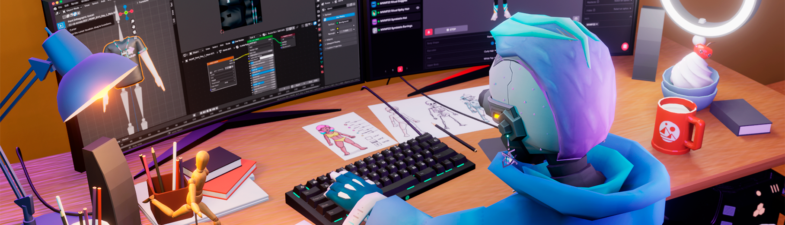

## Intro

This guide introduces the basics for creating custom 3D models for Decentraland wearables. It explains how the Decentraland avatar system works, and it illustrates how to properly model your own wearables.

_Note: this guide assumes that you already have some basic to intermediate knowledge of 3D modeling. If you’re new to 3D modeling,_ [_start here_](https://docs.decentraland.org/creator/3d-modeling/3d-models/)_._


**💡 Tip**: Install the [Decentraland Tools Blender plugin](https://extensions.blender.org/add-ons/decentraland-tools/). It includes several handy functions to help you edit and export 3D models, wearables, and emotes.


Before you get started, download the example files for reference meshes and textures: [**Wearables Reference Models**](https://drive.google.com/drive/u/1/folders/12hOVgZsLriBuutoqGkIYEByJF8bA-rAU)

## The Decentraland Avatar System

The Decentraland "avatar system" is the broad collection of different body components and subcomponents that can be decorated with custom wearables. These components are:

* Body shape
* Head
  * Head shape
  * Eyebrows
  * Eyes
  * Mouth
* Upper body
* Lower body
* Handwear
* Feet
* Accessories

### **Base Body Shape**

After downloading the base avatar example file, load the model into your 3D editor, like Blender.

You’ll notice that each model contains 8 different meshes related to an armature. These meshes represent the head, eyebrows, eyes, mouth, upper body, lower body, hands and feet. You can use these example models as a reference and starting point for your own custom wearable.

Currently, there are two body shapes: A or B. Shape A (`AvatarShape_A.blend`) is the **female** body, used for the `BaseFemale` representation. Shape B (`AvatarShape_B.blend`) is the **male** body, used for `BaseMale`. The file names don't make this obvious, so double-check before you build: a body-hugging wearable built on the wrong file ends up with its two representations swapped.

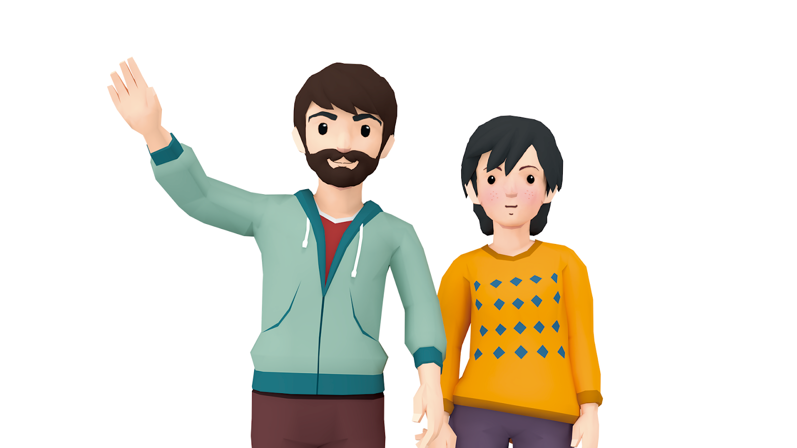

### **Head**

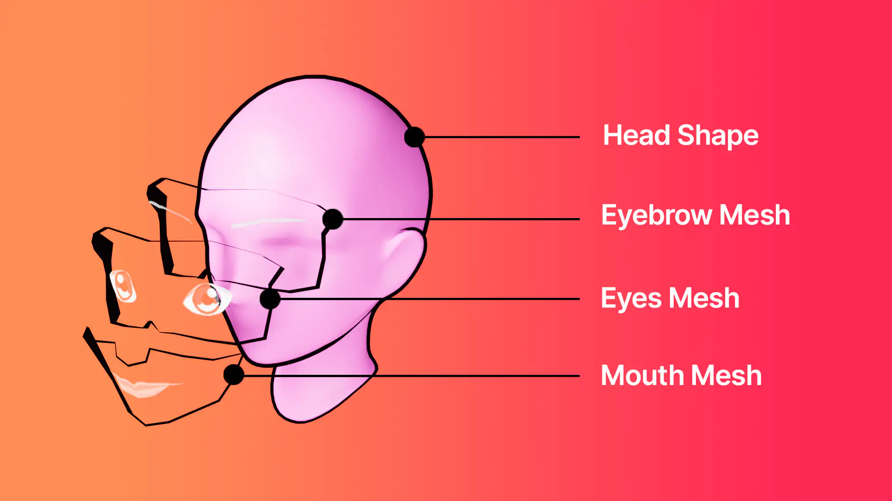

_The base head includes different meshes attached that can be customizables as wearables: Eyebrows, Eyes and Mouth work as transparency masks rendered in front of the face._

### **Upper Body**

_The upper body, or torso, of an avatar. Does not includes the hands._

### **Lower Body**

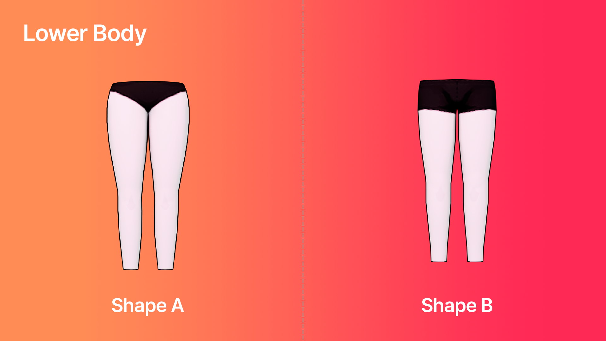

_The lower body includes the pelvis and legs of an avatar._

### **Hands**

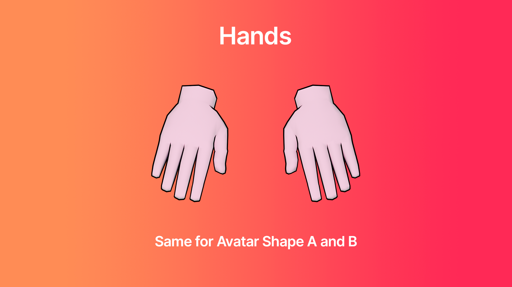

_The hands are the same for Shape A and B, and start on the wrists of an avatar._

### **Feet**

_Feet include ankles and foot._


**Important: Do not modify the vertices "cuts/stitches" between the head, upper and lower body.**


Each part of the body has caps, making them "water tight". These caps exist to prevent unsightly glitches if there are any animation clipping problems due to bad skin weighting. It’s best to not remove these caps when editing the mesh.

## Building 3D Models for Wearables

#### **Tris, materials and texture limitations**

To ensure that Decentraland runs smoothly for all players, it is important to create wearable models without using too many triangles, materials and textures. The goal is to keep the 3D models as simple as possible so they can be easily rendered, without sacrificing too much detail.

There are limits for the number of triangles and textures that can be used for each wearable or accessory:

* No more than 1.5K triangles per wearable slot: hat, helmet, upper body, lower body, feet and hair.
* No more than 500 triangles per categories: mask, eyewear, earring, tiara, top\_head and facial hair.
* For hand accessories, the budget is 1k tris. If the hand wear hides the base hand of the avatar, the budget is 1.5k tris.
* No more than 2 textures (at a resolution of 1024x1024px or lower) per wearable. All textures must be square at 72 pixel/inch resolution.
* No more than 2 materials (without counting the AvatarSkin\_MAT)
* In the case of skin wearable, the amount of tris allowed are 5k and 5 textures.


**Wearable Tris Combiner:**

_If the wearable hide other wearables the creator is allowed to combine the tris per slot. For example: if you want to do a jumpsuit you could create it using the upper body category hiding lower body; in that case you could have 1.5&#x4B;_&#x32;= 3K triangles.\*

In the case of the helmet, if you hide all the head wearables (head, earrings, eyewear, tiara, hat, facial\_hair, hair and top\_head you can reach the 4k tris, 2 materials and 2 textures)


#### Max Width, Height and Depth Dimension of the Wearables

There is a distance limit for wearables to ensure that they do not obstruct the visibility of other players screens or invading the scene space in an excessive way.

The dimension for the wearables cannot exceed:

> `Height: 2.42 m`, `Width: 2,42 m`, `Depth: 1,4 m`

 

#### **Maps**

Decentraland wearables currently supports 3 types of maps, which are:

1. **Base Color**: This is the main texture with the colors and details of your model.
2. **Emission**: This map is for the parts that are glowing in your model. The emission map goes in a separated material specifically for emission.
3. **Alpha**: This map is to handle transparency. It uses the opacity channel of the texture. (_It is always preferable to use Alpha Clip rather than Alpha Blend, using a black and white texture for the cutout_)

Because Decentraland reference client uses of a Toon Shader for the avatar materials, some maps are **not necessary** like:

* **Normal maps:** textures used to simulate high-resolution details on low-polygon models by encoding surface normals as RGB values.
* **Roughness maps:** textures used to define the surface roughness of 3D objects.

To use these maps in Decentraland the workaround is to bake them in one texture. You can find more info about baking textures here: [https://docs.blender.org/manual/en/latest/render/cycles/baking.html](https://docs.blender.org/manual/en/latest/render/cycles/baking.html)

#### **Normals**

**Decentraland engine render only one side normals.** (That means that a plane only will be visible from one side, the other side won’t be rendered) So, to ensure that your 3D is absolutely correct with the normals we can check that in two different ways.

The first one is to toggle the "Backface culling" on the Material properties settings, this is a good practice for spot inverted normals, like in this image:

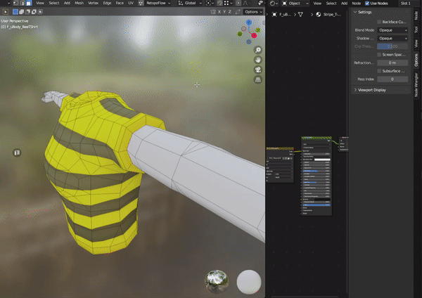 

The second way to check if the normals are right is by toggling "Face orientation" on the viewport overlay options. It will turn your model blue, but don’t worry. The blue faces are the correct ones and the red ones are the ones that needs to be corrected, you can find this option here:

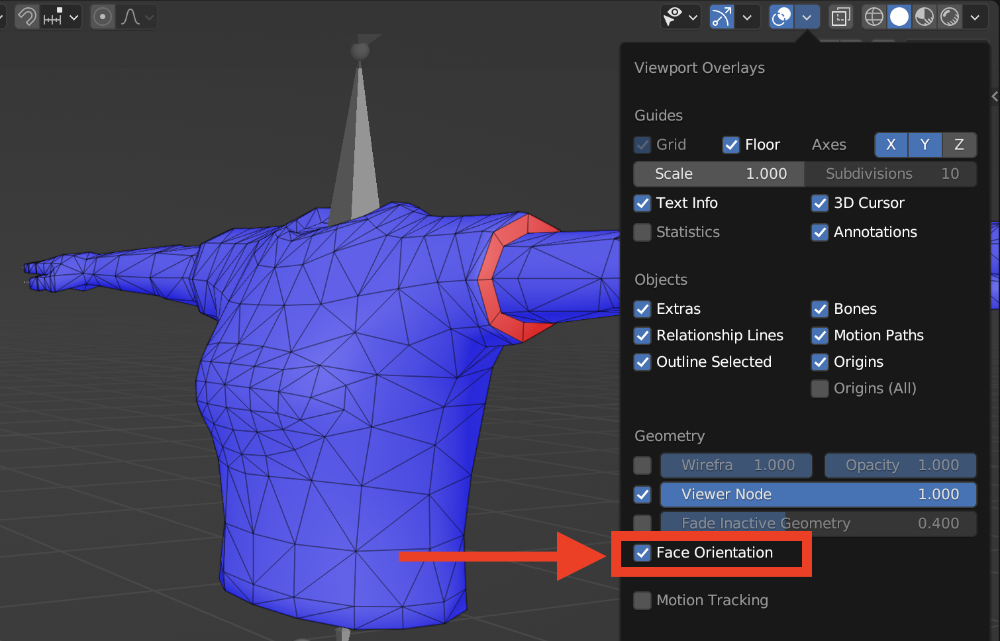

#### **Armature**

Remember not to change any of the specifications, naming conventions, hierarchy, or transforms of the given armature. Changing any of these will cause the wearable to stop working in the client after exporting.

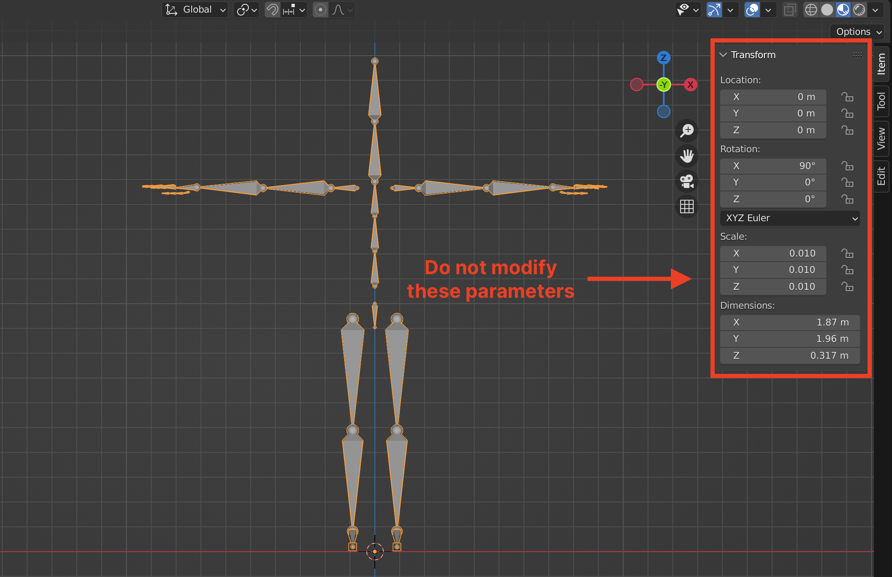

Be sure that the armature imported has no any _end_ or _neutral_ bones, otherwise the wearable is not going to work after exporting to the builder. If you are importing an .fbx that has this issue you can toggle _**Ignore Leaf Bones**_ when importing the armature.

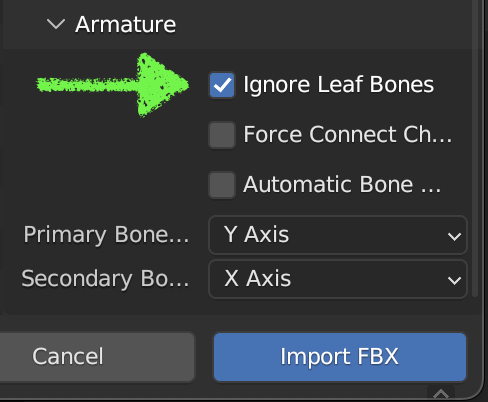


**Spring Bones:** Wearables can include extra bones beyond the base armature for dynamic physics (e.g., swaying hair, dangling earrings). These bones must contain `springbone` in their name. See [Spring Bones](https://docs.decentraland.org/creator/wearables-and-emotes/wearables/spring-bones) for full details.


#### **Eyebrows, Eyes and Mouth**

These meshes work with a transparent shader so you don’t have to do anything aside from creating your own png texture for the new eyebrow, eye, or mouth style you want and placing it correctly into the UV map. These textures should be 256x256px and need to have an alpha channel for transparency.

Here are some example png textures:

  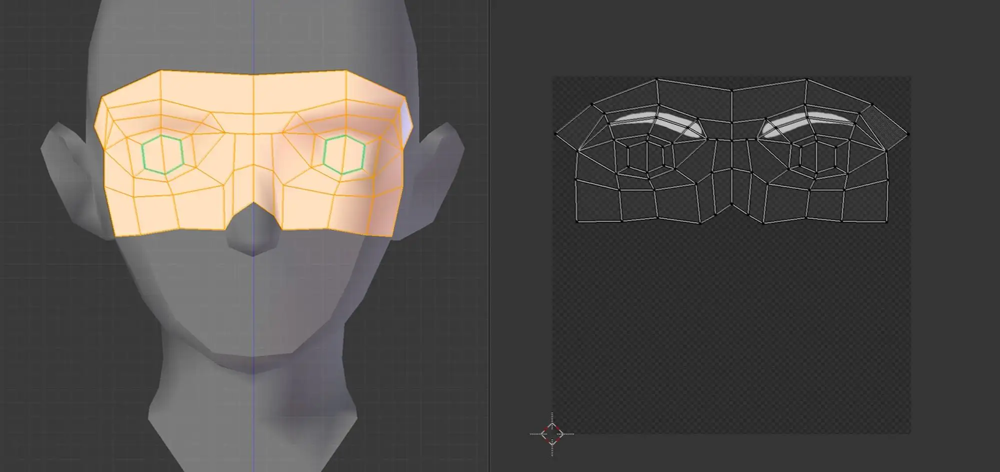

_Eyes and Eyewbrows use the same mesh and UV map._

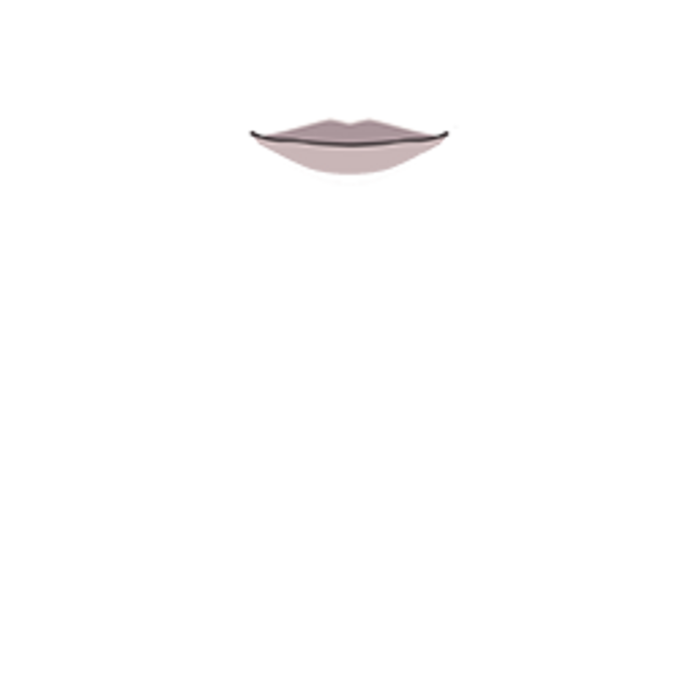 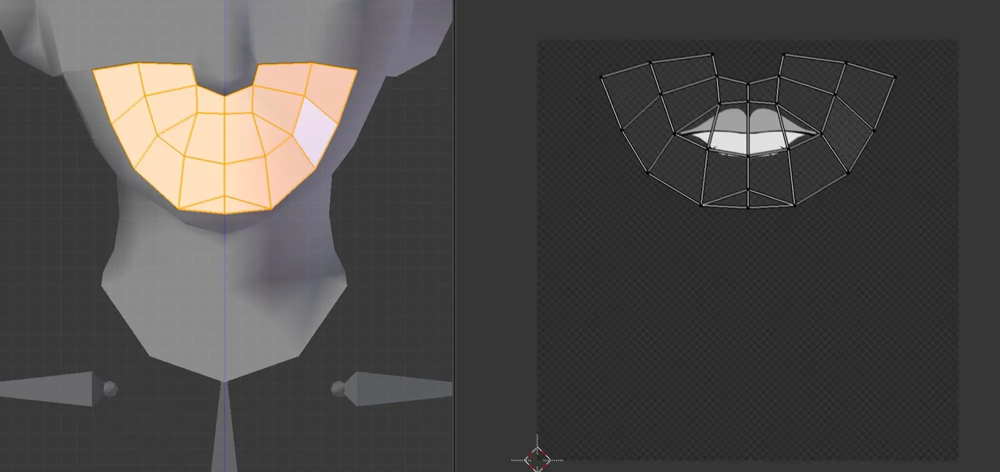

_Mouth mesh and UV map._

To visualize the final result you’ll need to use these nodes (in Blender):

 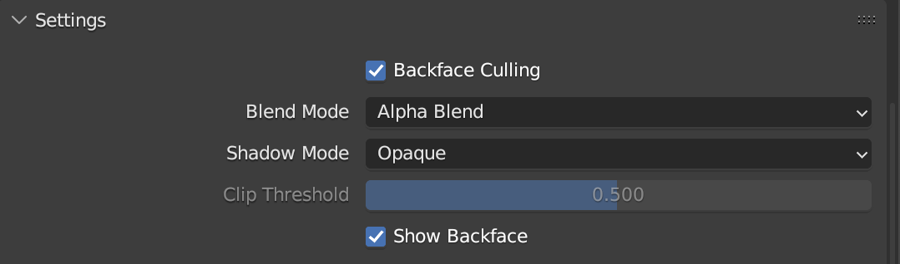

**Masks:** The Avatar Editor has different color options that players can choose from to customize their avatars.

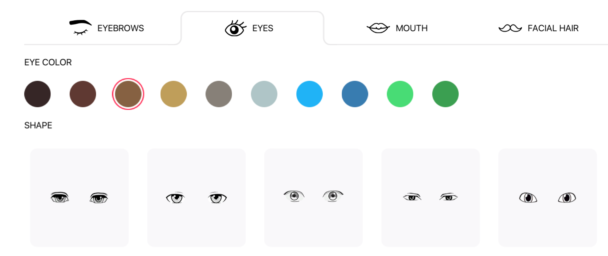

These color choices are applied to a specific mask in the wearable.

 

The black area in the image on the left (Eyes Mask) indicates the area of the texture on the right (Eyes Base) that will be colored. It’s important to remember that irises always need to have a grey scale (if the iris is pure black, the tint isn’t going to work. By the contrary, if the iris is pure white it would be fully tinted by the selected color using the editor).

#### **Handwear**

There are two types of **Handwear** you can do under the same category.

1. **Replacing Hands:**

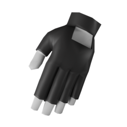

If you want to create handwear that replaces both hands you would probably need to override the _**hand**_ base mesh. Doing that, the limit for the handwear wearable would be 1500 tris.

2. **Hand Accessories:**

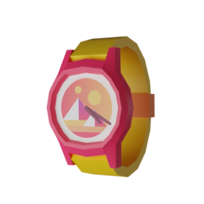

Also you can create hand accessories like watches, bracelets, rings, etc. In that sense, the hand doesn't need to be overridden and the limit is 1000 tris per item.


Note: The **handwear** category is specifically for hand accessories or replacing hands that follow the avatar armature with proper skinning. It is not meant for items such as swords, shields, or any similar asset. Submitting an item that doesn't follow these specifications may result in rejection by the curators committee.


#### **Hair and Facial Hair**


**Tip:** Hair and other hanging accessories can now use **spring bones** to move dynamically in response to avatar movement and gravity. Instead of static hair, you can add spring bone chains to make ponytails, braids, and long hair sway naturally. See [Spring Bones](https://docs.decentraland.org/creator/wearables-and-emotes/wearables/spring-bones) for a complete guide.


There are two important things to remember when creating custom hair wearables.

First, try to follow the shape of the head. You can always refer to the head mesh provided in the example files if you need a place to start.

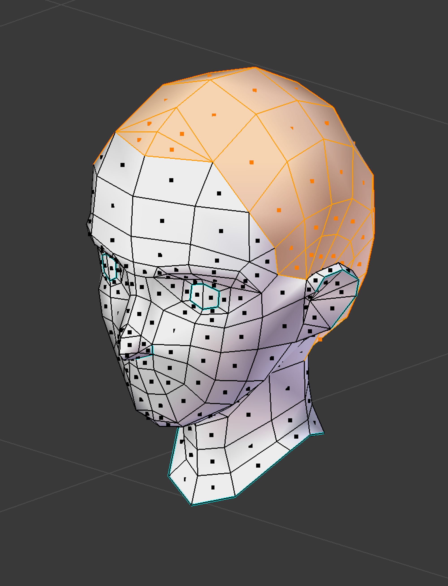

Second, if you want users to be able to change the color of the hair or facial hair using the avatar editor, then you need to paint the hair in grayscale and use "Hair" in the naming of the material (example "M\_Hair\_Short"). If you want to include other object which doesn't is influenced by tint just don't add that naming convention.

  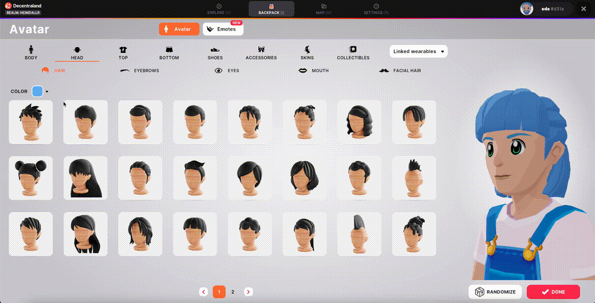

_Lower tones of gray will appear darker and higher tones of gray will appear brighter, multiplied by the color selected from the user in the avatar editor._

### **Base Materials and Textures**

There are three basic materials for avatar models. One is the material used for the wearable itself, another one is used for the skin and another one for the eyebrows, eyes and mouth.

Each base mesh comes with its own skin texture.

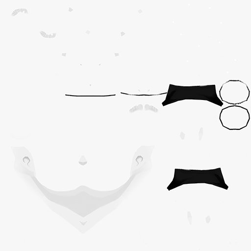 

The skin texture is made in grayscale so it allows the render engine to tint the skin of the avatar using the editor according to the user’s preference. In order to be able to tint the skin color using the editor the name of the material must be _AvatarSkin\_MAT_.


Important: always preserve the UV mapping for any body part that is exposed by a wearable, like the legs exposed by the shorts or skirts.


\src="../images/wearables-and-emotes/creating-wearables/19\_skin\_uv.png"width="600"/>

You can create custom textures for your wearables! However, it’s always best to use a single, very small, texture file for each wearable. Using the default AvatarWearable\_MAT texture provided in the example files will guarantee that your wearables are performant!


To prevent triggering facial feature-specific shaders, do not include '\_mouth,' '\_eyebrows,' or '\_eyes' in the naming of any meshes. These terms are reserved for facial features, and using them inappropriately will apply the wrong shader to the mesh.


✨ In the case you want to do your own textures for the model we recommend the following addons for better UV Unwrapping:

**UVPacker**

UvPacker is a free addon that helps you to pack and organize your uvs with just a few clicks. As Decentraland works with textures of up to 1024x for the wearables this tool is a great assist to create better and more organized textures.

You can download directly from the website here:

[**https://www.uv-packer.com/download/**](https://www.uv-packer.com/download/)

**UVToolKit**

UvToolKit is a addon that helps you to expand your UV settings and options to create great UVs in blender.

Here is the link for the download: [**https://alexbel.gumroad.com/l/NbMya**](https://alexbel.gumroad.com/l/NbMya)

### **Skin Weighting**

Skin weighting is the process of determining which bones in the avatar’s rigging affect which wearables during an animation.

When skin weighting our new wearables, there are several considerations we need to keep in mind.

Each asset must be weighted to the full skeleton. For example, an upper body asset will look like this when applying skin weights:

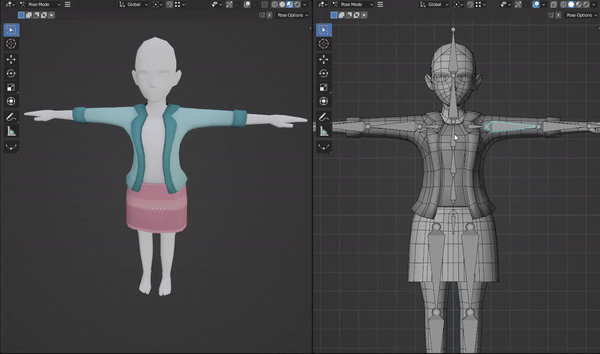

Wearables that meet at intersections between body parts must be fully weighted to the same bone. For example, in these two green zones, the vertices in the neck need to be fully weighted to the "Neck" bone only.

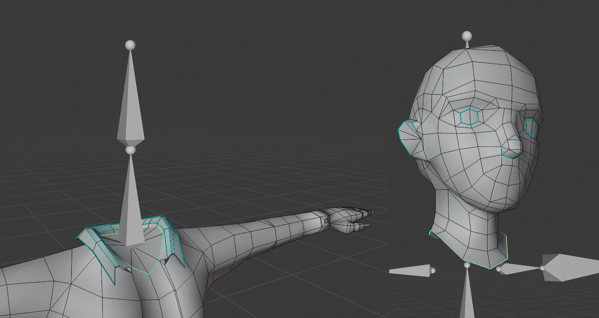

#### **Key Bones**

The "key" bones to use when skin weighting are:

**Head Bone:** for the hair, earrings, tiaras, eyes, eyebrows, mouth and any accessory that needs to follow the head’s movement.

**Neck Bone:** for the main head and upper body’s intersecting vertices.

**Hips Bone:** for the upper body and lower body’s intersecting vertices.

**Right Leg and Left Leg Bones:** for the lower body and feet intersecting vertices.

**Right Forearm and Left Forearm** for the hands intersecting vertices.


⚠️ **Hint**

* Remember, you can use any bone to influence any mesh’s vertices! For example, you could create a new foot mesh for a tall pair of boots, and skin weight the top of the boot to the "Leg Bones". Or, you could create some long hair and use the "Shoulder" or "Spine" bones to influence the hair when the avatar moves around.
* It's always recommendable to keep a symmetry from both sides of the rig, left and right should have similar bone influences.
* As a common advice, a vertex cannot be influenced by more than 4 bones or joints.
* Keep in mind to export the armature exactly as the one provided in the documentation. If it has any other bones like _"\_end\_bones"_ or similar is not going to work on the client.


#### **Rigid Parts**

For parts that shouldn't bend, like a backpack, a jetpack or armor plates, weight every vertex of the part 100% to a single bone. For example, use `Avatar_Spine2` for anything on the back. Then join the part into the wearable's mesh, so the wearable stays a single skinned mesh.

`Avatar_Spine2` sits at the same place on both body shapes, so a part weighted to it can use the same position on both.

A rigid part on the back can look like it floats, because the back curves away from a flat part. Measure the gap under the part's whole footprint and place its front face about 4 mm from the furthest point of the back. Alternatively, add a small mount block between the part and the back, and weight the mount's front vertices like the body vertices they touch, so the mount bends with the spine.

#### **Exporting Wearables**

When exporting wearables, make sure there are no other bones outside of the given Armature, **except for spring bones** (bones with `springbone` in their name, used for dynamic physics). A common problem when importing armatures between different software is the appearance of _"\_end"_ or _"\_neutral"_ bones. Be sure to remove those before exporting. Otherwise, it is very likely that the wearables will not work on the client afterwards.

To export the wearable, select the object and then the armature. Be sure to not export anything else, such as cameras, lights, or empty objects.

A valid wearable made of a single mesh has 64 nodes in its exported file: the `Armature`, its 62 bones and the skinned mesh. Spring bones add one node each.

Next, export the wearable in _glTF2.0_ format. Make sure you only export the wearable with its skinning properties, and without any other unnecessary features like animation or shape keys.

## Good Practices For Modeling

### **Change Your Mesh From T-Pose To A-Pose**

When you’re making wearables, the best way to visualize the final result, and to facilitate how you handle topology and position of the wearable is to work with the model in A-Pose. In order to do that you have to follow this simple steps:

1. First select the upper body, then you have to toggle "**Edit mode**" and "**On cage**" in the armature modifier.

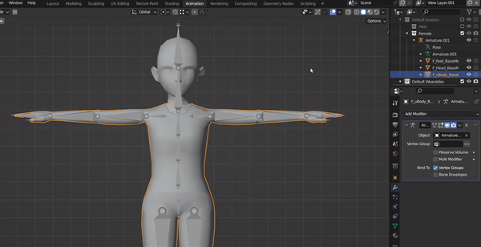

2. Now, in pose mode you can rotate the arms 60°.

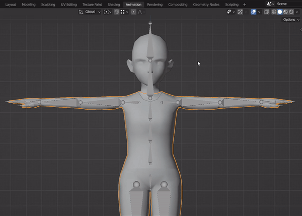

3. You can edit your mesh in A-Pose instead of T-pose.

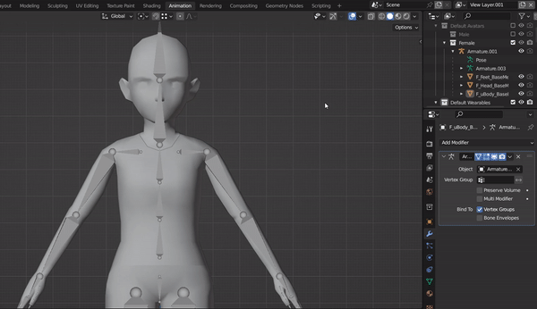

4. But it is also good to keep in mind that you can easily alternate from A-Pose to T-Pose just toggling back the "Edit mode" and "On cage" in the armature modifier.

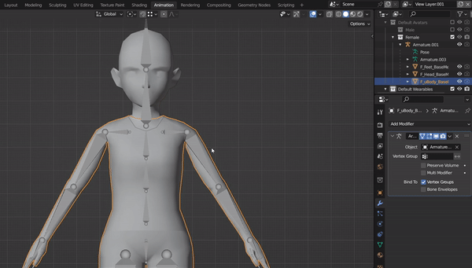

### **Joint deformation:**

In order to get the best results on the wearable topology when it comes to joints (arms or legs, for example) it's important to have good practices when creating loops. Here we can see the difference on the deformation of the mesh for different loop cuts:

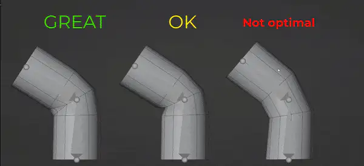

A good way to ensure that everything is deforming correctly is to do a weight paint like the following example:

 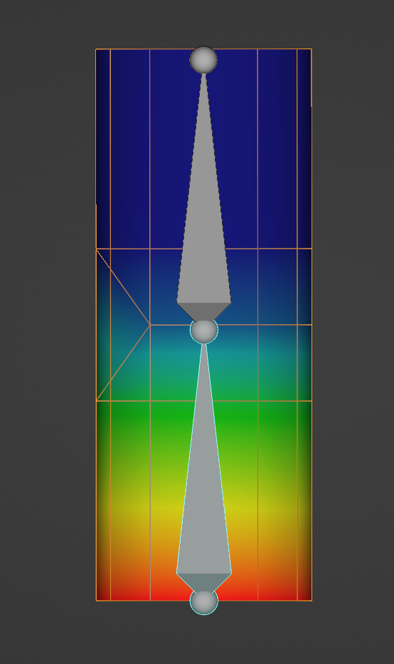

### **Skirts**

A useful tip and good practice when modeling skirts/dresses is to add additional loopcuts in the intersections of the folds. This will be very handy when you have to paint the weights of the rig.

With this loopcuts the vertex influence look a lot more smooth and give you better results when you’re animating a skirt/dress.

Here is an example of how the bone influence should be:

### **Hats**

A good practice when creating hats is to add a hair to the base mesh of the hat and then hide the category _hair_ using the editor. Doing this is going to prevent that the hat clips with other hairs and reduce unexpected results.

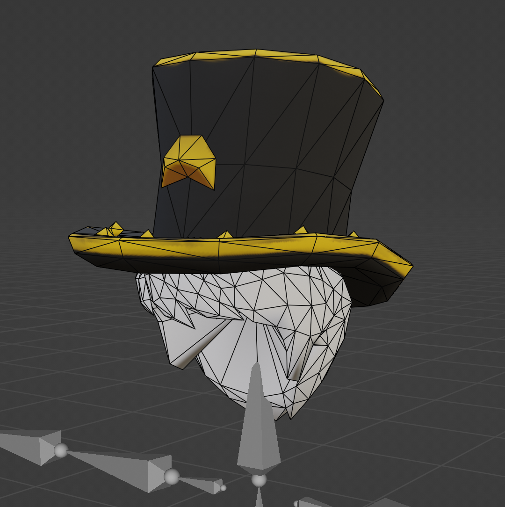

### **Add Polygon Count**

A valuable tip is to always keep on track of the polycount of your models. To do that in blender you need to turn on statistics on the viewport overlays panel.

### Resources

In this shared folder you can find base models, textures, and various other resources, including examples of fully-created wearables. Feel free to leverage these resources when creating your own.

[**Wearables Reference Models**](https://drive.google.com/drive/u/1/folders/12hOVgZsLriBuutoqGkIYEByJF8bA-rAU)
