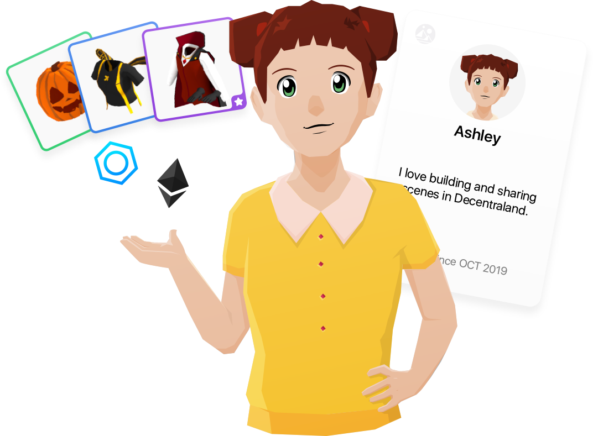
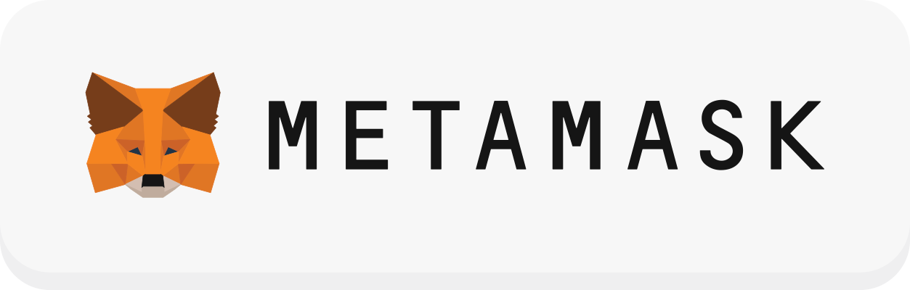
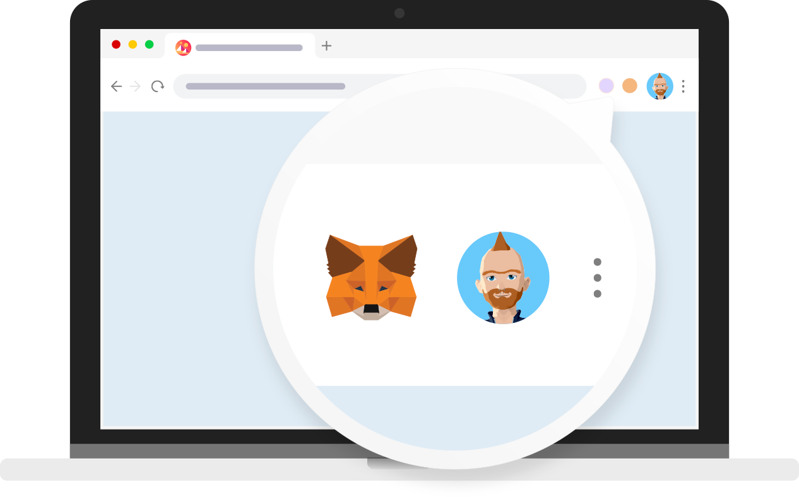
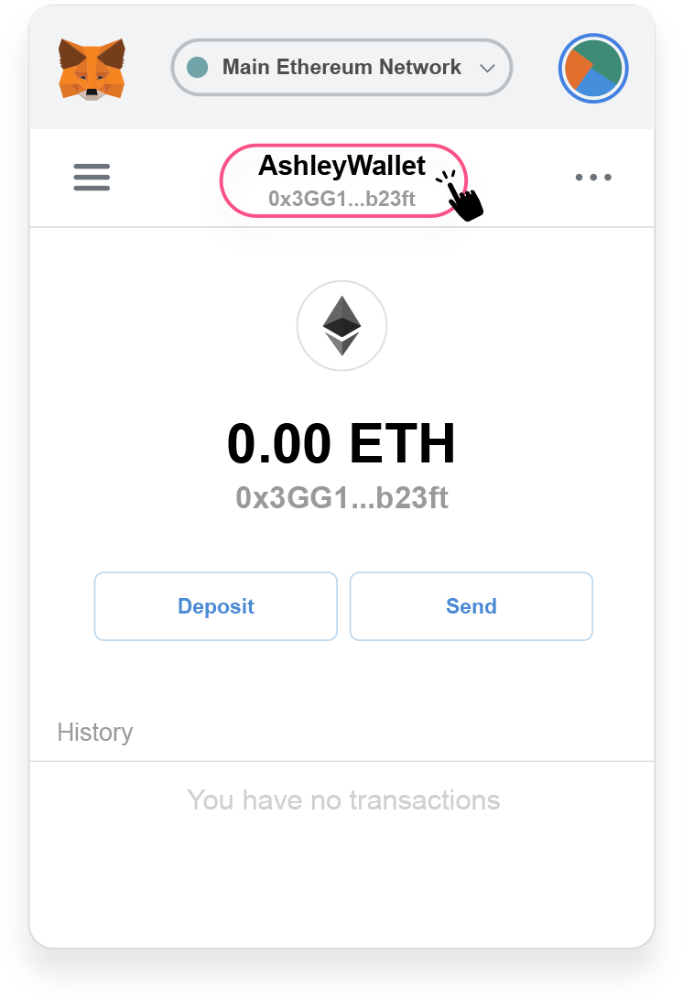
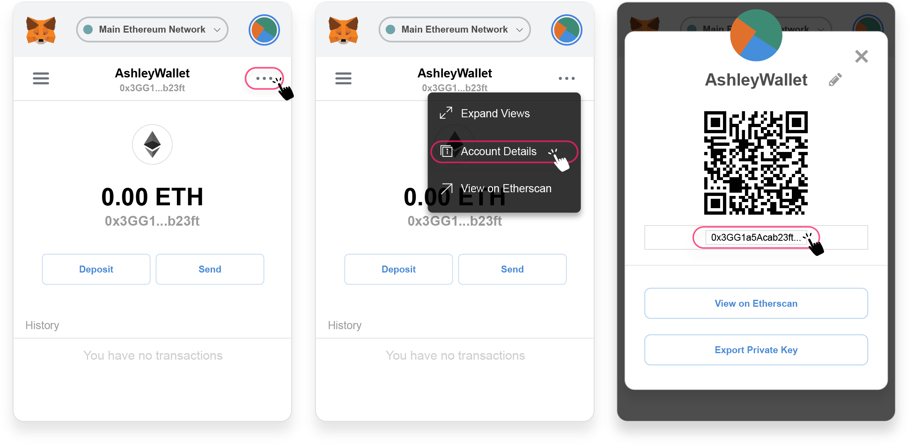
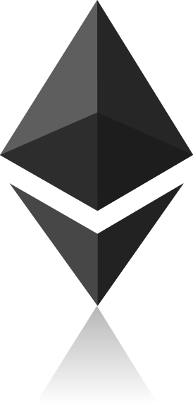
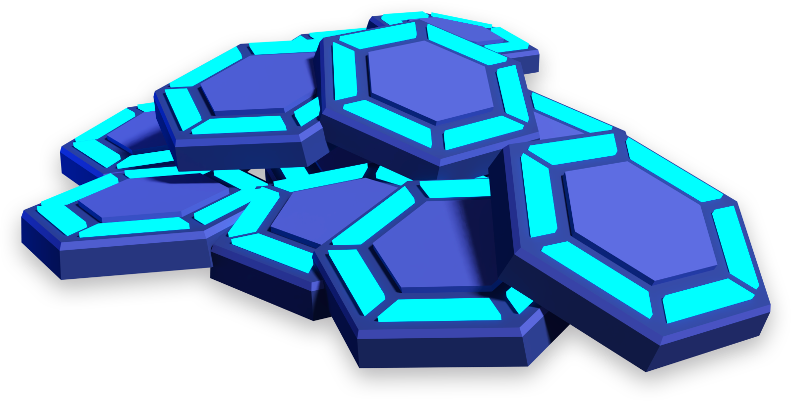
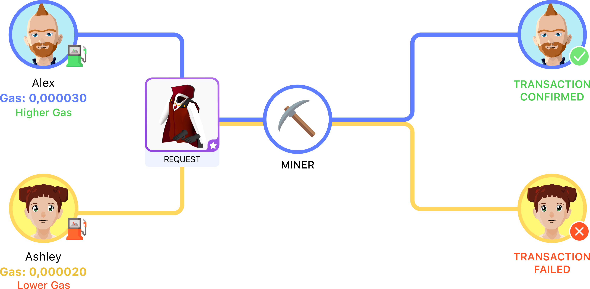

# Obtener una Billetera

## ¿Qué es una billetera?

Decentraland usa la blockchain de Ethereum para registrar la propiedad de todos los activos digitales y artículos comerciables.

Las billeteras digitales son herramientas que funcionan como un puente entre la blockchain y la dApp (aplicaciones descentralizadas). Esto significa que con una billetera podrás monitorear tus fondos disponibles, historial de transacciones y opciones de seguridad.

## ¿Necesito una billetera para jugar en Decentraland?

No, no necesitas poseer cripto o tener ya una billetera digital para usar Decentraland. Decentraland es gratuito para usar, y si deseas comprar algo del [**Marketplace**](https://market.decentraland.org/), puedes usar una tarjeta de crédito/débito además de criptomoneda.

Consulta un tutorial para [**crear una cuenta con un perfil social**](https://www.youtube.com/watch?v=ylZrPisyPl4) o [**con una billetera externa como MetaMask**](https://www.youtube.com/watch?v=w3CCVrVe1M4).

## ¿Cómo obtengo una billetera digital?

Para entrar a Decentraland, debes usar una billetera que esté integrada a tu navegador web, por lo que recomendamos [MetaMask](https://metamask.io/)

Una vez que lo instales, verás un ícono como este:

## Dirección de billetera

Todas las billeteras tienen una clave pública y privada. Una clave pública es un identificador único para tu billetera y se ve así: **0xcba113f589805095a892ecefdb4eb83eff45d98**. Es básicamente un nombre que puedes compartir libremente con otros y se usa para dirigir activos a tu billetera.

Puedes localizar tu dirección de billetera haciendo clic en el ícono de extensión en tu navegador, y luego haciendo clic en el nombre de tu billetera con la clave pública para copiarlo al portapapeles:

O haciendo clic en los detalles de tu cuenta:

La clave privada es utilizada por tu billetera para firmar cada transacción y certificar que realmente fue enviada por ti. También se usa para restaurar tu billetera en caso de que olvides tu contraseña.

Ten en cuenta que una billetera digital es como una cuenta bancaria, así que asegúrate de **no olvidar tu contraseña o frase de respaldo. Guárdalas en un lugar seguro y no las compartas con nadie.**

## ¿Qué es Ether (ETH) y cómo lo envío a mi billetera?

Para ejecutar transacciones, necesitarás poner dinero en tu billetera. Las dApps basadas en Ethereum, como Decentraland, usan Ether: una moneda digital que alimenta la red de Ethereum. Actúa como cualquier otra moneda, en que su valor fluctúa con el mercado.

* Necesitas convertir tu moneda (por ejemplo, USD, CAD, GBP) en Ether para pagar por cosas como coleccionables.

## ¿Cómo obtengo Ether?

_Solo para ciudadanos de EE. UU.:_

Puedes comprar ETH para la Extensión de Navegador MetaMask con el servicio de Coinbase.

* Haz clic en el botón `Comprar`.
* Selecciona la opción `Coinbase`.
* Haz clic en el botón `Continuar a Coinbase` para comprar Ethereum.

_Para el resto del Mundo:_

Necesitas comprar ETH de Coinbase u otro exchange usando moneda fiat normal.

* Copia tu dirección de MetaMask haciendo clic en el nombre de tu cuenta y dirección.
* Selecciona `Copiar Dirección al portapapeles`.
* Ve a Coinbase u otro exchange.
* Haz clic en `Cuentas` en tu navegación superior.
* Selecciona tu billetera ETH y haz clic en `comprar`.
* Sigue los pasos para `Agregar método de pago` y pega tu dirección de MetaMask con la cantidad que deseas transferir.

## ¿Qué es MANA y cómo lo obtengo?

[MANA](https://etherscan.io/token/decentraland) es el token de criptomoneda fungible (reproducible o intercambiable) de Decentraland. Se quema, o gasta a cambio de parcelas LAND, wearables y nombres.

Pasos para comprar MANA:

* Primero, necesitas registrarte con un exchange que liste MANA (como [Coinbase](https://www.coinbase.com/), [Huobi](https://www.huobi.io/), [Binance](https://www.binance.com/)).
* En segundo lugar, necesitarás depositar fondos en tu cuenta. Aunque las cosas cambian rápidamente en el mundo cripto, no es probable que haya un exchange disponible para convertir tu USD directamente por MANA. Si ese es el caso, primero necesitarás obtener una criptomoneda listada en un par de monedas con MANA, como Ether (ETH), y luego intercambiarla por el token nativo de Decentraland.
* Tercero, una vez que hayas iniciado sesión en tu cuenta de exchange, haz clic en el enlace "Mercados" o "Exchange" y busca tu par de monedas deseado. Por ejemplo, MANA/ETH. En el campo "Comprar", puedes especificar la cantidad de MANA que deseas comprar o la cantidad de ETH que deseas gastar. Asegúrate de tomarte un momento para revisar los detalles completos de la transacción, incluidas las tarifas que se aplican y el costo total de completar tu compra.

## ¿Qué es 'gas'?

'Gas' es un término abreviado utilizado para describir el costo de alimentar una transacción o contrato en Ethereum. Debido a que blockchain está descentralizada, cada transacción se distribuye a través de múltiples computadoras, no un servidor central. Esto asegura que cada token – en este caso, cada coleccionable – sea seguro y único. También requiere mucho poder computacional, que está cubierto por el costo del gas.

* _'Gas' se compone de dos partes: Precio de Gas y Límite de Gas. El Precio de Gas es lo que ofreces pagar a los mineros (en una pequeña medida de ether llamada 'gwei') por cada operación para ejecutar el contrato inteligente. El Límite de Gas es cuántas operaciones les permites hacer antes de que se queden sin gas y abandonen la transacción._
* _1 gwei = 1/1,000,000,000 de un Ether._

Para resumir, el Precio de Gas (gwei) es la cantidad de Ether ofrecida por unidad de gas para pagar a los mineros para procesar tu transacción. Cuanto más alto sea el precio de gas que establezcas, más rápido se procesará tu transacción. Entonces, para transacciones más importantes – como un coleccionable que realmente te gusta ;D – piensa en aumentar el precio de gas sugerido.

**Para información técnica adicional, visita** [**Acerca del blockchain**](ethereum-essentials.md)
