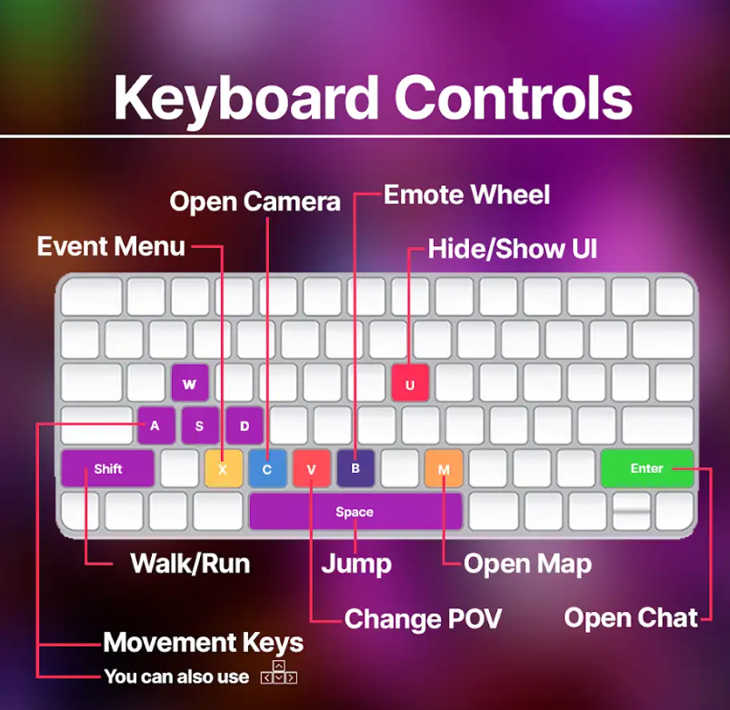
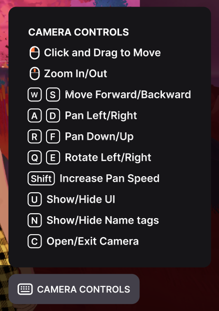
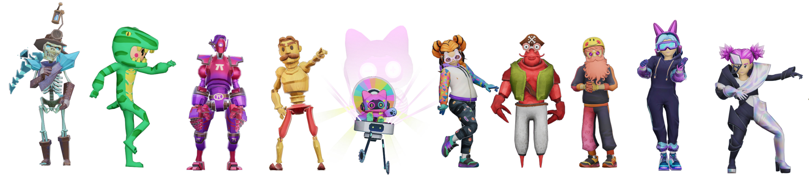
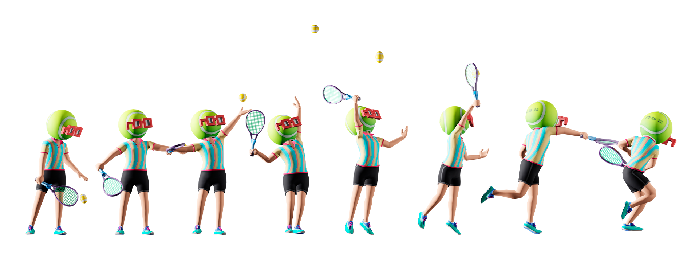
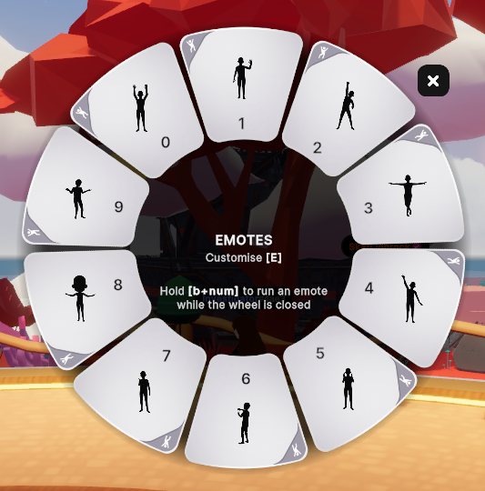

# Decentraland 101

## Primeros Pasos

¿Cómo entro a Decentraland?

1. El primer paso es descargar la aplicación de Decentraland en tu computadora. Ve a la página de descargas [aquí](https://decentraland.org/download?utm_org=dcl\&utm_source=decentraland\&utm_medium=organic\&utm_campaign=evergreen\&utm_term=generaldocs\&utm_content=faq).
2. Una vez que hayas instalado y cargado exitosamente Decentraland en tu computadora, se te pedirá que inicies sesión en tu cuenta de Decentraland, un proceso que ocurre en línea, así que puedes esperar que se abra una ventana del navegador.
3. Crea e inicia sesión en tu cuenta de Decentraland conectando tu cuenta de Google o Discord u otro perfil social o una billetera digital como MetaMask o Coinbase. Consulta un tutorial para [crear una cuenta con un perfil social](https://www.youtube.com/watch?v=ylZrPisyPl4) o [con una billetera externa como MetaMask](https://www.youtube.com/watch?v=w3CCVrVe1M4).
4. Una vez completada la verificación en línea, abre la ventana de la aplicación de Decentraland en tu computadora y haz clic en 'Saltar a Decentraland'.
5. ¡Estás dentro! Desde aquí puedes hacer clic en el ícono de la mochila para personalizar tu avatar, correr explorando el mundo construido por la comunidad de Decentraland, o asistir a un [evento](https://decentraland.org/events?utm_org=dcl\&utm_source=generaldocs\&utm_medium=organic\&utm_content=faq) y hacer algunos amigos. ¡Diviértete!

¿Necesito cripto o una billetera digital para usar Decentraland?

No, no necesitas poseer cripto o tener ya una billetera digital para usar Decentraland. Decentraland es gratuito para usar, y si deseas comprar algo del [Marketplace](https://market.decentraland.org/), puedes usar una tarjeta de crédito/débito además de criptomoneda.

Consulta un tutorial para [crear una cuenta con un perfil social](https://www.youtube.com/watch?v=ylZrPisyPl4) o [con una billetera externa como MetaMask](https://www.youtube.com/watch?v=w3CCVrVe1M4).

En Decentraland los usuarios realmente poseen sus activos digitales, como Wearables o NAMEs, con la propiedad registrada en la blockchain. Para habilitar esto, cada cuenta de Decentraland está vinculada a una billetera digital única. Sin embargo, si aún no tienes una billetera digital, no necesitas conseguir una tú mismo. Si inicias sesión en Decentraland con una cuenta social como Google o Discord, se creará una billetera digital para tu cuenta detrás de escena, así que no tienes que preocuparte por nada.

¿Qué hardware necesito para ejecutar Decentraland?

Actualmente, Decentraland está disponible para PC en Windows y Mac. Las especificaciones mínimas de hardware para que Decentraland funcione sin problemas se enumeran a continuación:

**Windows**

|         | Mínimo Requerido                                                       | Configuración Recomendada                        |
| ------- | ---------------------------------------------------------------------- | ------------------------------------------------ |
| SO      | Windows 10 64-bit                                                      | Windows 11 64-bit                                |
| CPU     | Intel i5 7ª generación o AMD Ryzen 5 Series                            | Intel i7 12ª generación o AMD Ryzen 7 Series     |
| GPU     | Nvidia RTX 20 Series o AMD Radeon RX 5000 Series (compatible DirectX 12) | Nvidia RTX 30 Series o AMD Radeon RX 6000 Series |
| VRAM    | 6 GB                                                                   | 12 GB                                            |
| RAM     | 16GB                                                                   | 32 GB                                            |
| Almacen | 8GB HDD                                                                | 20GB SDD                                         |

**Mac**

|         | Mínimo Requerido                                       | Configuración Recomendada      |
| ------- | ------------------------------------------------------ | ------------------------------ |
| SO      | macOS 11 Big Sur                                       | macOS 12 Monterey              |
| CPU     | Apple M1                                               | Apple M1 Pro/M2                |
| GPU     | Apple M1 GPU integrado (soporte Metal requerido)       | Apple M1 Pro/M2 Pro GPU integrado |
| VRAM    | 6 GB                                                   | 12 GB                          |
| RAM     | 16GB                                                   | 32 GB                          |
| Almacen | 8GB HDD                                                | 20GB SDD                       |


**📔 Nota**: Decentraland actualmente no funciona en ningún dispositivo móvil.


¿Cómo exploro y navego por Decentraland?

Decentraland consiste en la **Genesis City** abierta y transitable, compuesta por parcelas comunitarias que se referencian por coordenadas (por ejemplo, Genesis Plaza, el punto de aparición predeterminado central de Decentraland está en 0,0), así como **Worlds** individuales, espacios 3D más íntimos en el ecosistema de Decentraland a los que se puede teletransportar.

Para explorar **Genesis City**, puedes correr usando las teclas de flechas o WASD, saltar a ubicaciones haciendo clic en ellas desde el mapa, o teletransportarte escribiendo el siguiente comando en el cuadro de chat y presionando 'Enter':

• `/goto x,y` (x,y son las coordenadas de una escena)

Para teletransportarte a un **World** específico, también usarás un comando de chat:

• `/goto NombreDelWorld`

¿Cómo obtengo Wearables, Emotes, LAND y NAMEs en el Marketplace?

¿Listo para comenzar tu ola de compras en Decentraland en el [Marketplace](https://decentraland.org/marketplace/)? Navega a través de cientos de Wearables y Emotes hechos por la comunidad para personalizar tu identidad digital, compra o alquila parcelas LAND de Genesis City, o reclama tu NAME único (¡que viene con su propio World!).

Una vez que hayas encontrado un artículo que te gustaría comprar, puedes pagar fácilmente con tarjeta o con una amplia variedad de criptomonedas. Si estás comprando un Wearable o Emote, el artículo aparecerá en tu Mochila en cuestión de minutos y puedes sentirte feliz sabiendo que estás apoyando a los creadores de Decentraland, ¡quienes mantienen el 97.5% de las ventas!

Cualquier cosa que compres en el Marketplace es verdaderamente tuya, con tu propiedad registrada en la blockchain. Puedes revender artículos cuando desees, lo que también apoyará al creador original con un 2.5% de regalías.

¿Cómo puedo conocer gente en Decentraland?

La mejor manera de conocer gente nueva en Decentraland es asistir a [eventos](https://decentraland.org/events?utm_org=dcl\&utm_source=generaldocs\&utm_medium=organic\&utm_content=faq) y ¡comenzar a chatear! Navega por la página de eventos para eventos actuales y próximos y no seas tímido una vez que entres, la comunidad de Decentraland es conocida por ser acogedora. 💜

¡Estate atento a tours y encuentros semanales, como ABC DCL - Adventures of Decentraland, que están específicamente dirigidos a nuevos miembros de la comunidad!

¿Cómo puedo aprender sobre eventos en el mundo?

La [Página de Eventos](https://decentraland.org/events?utm_org=dcl\&utm_source=generaldocs\&utm_medium=organic\&utm_content=faq) de Decentraland es el lugar oficial donde cualquier persona en la comunidad puede publicar sus eventos en el mundo para invitar a todos a venir. Para mantenerte al tanto de los eventos, consulta la página de eventos regularmente y también puedes seguir a Decentraland en canales sociales, como [X](https://x.com/decentraland), o [suscribirte](https://decentraland.beehiiv.com/) al boletín semanal para conocer las próximas actividades!

¿Cómo tomo fotos en el mundo?

Si deseas obtener instantáneas de tus momentos favoritos en Decentraland, solo presiona C en tu teclado para abrir la Cámara. Una guía útil con controles de cámara se puede encontrar en la parte inferior derecha de tu pantalla.

Tu Galería tiene espacio para hasta 500 fotos, desde allí puedes compartir fácilmente tus imágenes con un enlace o descargarlas en tu computadora.


**Consejo profesional:** Presenta tus fotos favoritas en tu Perfil de Decentraland activando la opción 'Establecer como Público' desde el menú de tres puntos en la esquina superior derecha de tu foto seleccionada.


¿Cómo puedo participar en la gobernanza de Decentraland?

El DAO de Decentraland es el corazón de la gobernanza del mundo impulsado por la comunidad. Para comenzar, puedes leer los [foros del DAO](https://decentraland.org/governance) para conocer los problemas actuales, ver cuál es el consenso de la comunidad y agregar tus propios comentarios. Aprende más en la [página oficial del DAO](https://decentraland.org/dao/).

## Los Básicos

¿Qué son los Wearables?

Los Wearables son los activos digitales que puedes mezclar y combinar para personalizar la apariencia de tu avatar. Van desde artículos de ropa, accesorios, partes del cuerpo y pieles completas.

Una variedad de Wearables base gratuitos siempre están disponibles en tu Mochila (¡haz clic en el ícono de la mochila a la izquierda cuando estés en el mundo para probarlos!), y puedes navegar a través de miles de artículos hechos por la comunidad en el [Marketplace](https://decentraland.org/marketplace/browse?section=wearables\&vendor=decentraland\&page=1\&sortBy=newest\&status=on_sale) para crear tu look único. ¿No encuentras lo que buscas? Considera hacer el tuyo propio.

¿Qué son los Emotes?

Los Emotes son animaciones que permiten a tu avatar expresar reacciones, realizar movimientos de baile o participar en actividades como yoga o pintura. Al igual que los Wearables, hay un conjunto de Emotes base gratuitos disponibles para todos, pero también puedes navegar por el [Marketplace](https://decentraland.org/marketplace/browse?assetType=item\&section=emotes\&vendor=decentraland\&page=1\&sortBy=recently_listed\&status=on_sale) para encontrar una variedad aún mayor. ¡O hacer los tuyos propios!

Para usar Emotes en Decentraland, querrás familiarizarte con la Rueda de Emotes que se muestra a continuación. Esta muestra un conjunto de los 10 Emotes que es más probable que uses (puedes personalizar estas ranuras de Emotes desde tu Mochila).

Para activar un Emote, tienes 3 opciones:

* **Principiante:** Haz clic en el ícono de una persona bailando en la parte inferior izquierda de tu pantalla para abrir la Rueda de Emotes y haz clic en el Emote que deseas usar
* **Intermedio:** Presiona **B** en tu teclado para abrir la Rueda de Emotes y haz clic en el Emote que deseas usar
* **Profesional:** Usa el atajo **B** + el número del Emote que deseas usar (por ejemplo, **B1**) en tu teclado para activar un Emote sin abrir la Rueda de Emotes

¿Qué es un NAME?

Un NAME de Decentraland es como un nombre de usuario oficial para tu avatar, de tu propiedad en la blockchain. Cuando ves otros avatares con un nombre que no tiene algo como '#1234' al final, es porque han equipado un NAME a su avatar.

Tener un NAME de Decentraland viene con algunas ventajas adicionales: además de hacer que tu avatar sea únicamente reconocible, cada NAME viene con un World—tu espacio virtual personal para experimentar con construcciones u organizar tus propias reuniones. Cada NAME que posees también te da 100 VP (Poder de Voto) para usar en la [gobernanza del DAO](https://dao.decentraland.org/). Los NAMEs de Decentraland también son parte de la red ENS, por lo que podrías usar tu NAME en toda la Web3.

[Reclama tu NAME único](https://decentraland.org/marketplace/names/claim) ahora o consulta primero un [tutorial útil](https://www.youtube.com/watch?v=OKqXmO5fD0s\&ab_channel=Decentraland).

Una vez que hayas reclamado tu NAME, asígnalo a tu avatar en [decentraland.org/builder/names](https://decentraland.org/builder/names).

¿Qué es MANA?

[**MANA**](https://etherscan.io/token/decentraland) es el token de criptomoneda fungible ERC20 de Decentraland. MANA se puede usar para comprar parcelas LAND, NAMEs y otros activos digitales o se puede intercambiar por varios bienes y servicios dentro del ecosistema de Decentraland. Para un resumen actual de estadísticas críticas como el suministro total y circulante, visita el panel de transparencia [**Información del Token MANA**](https://governance.decentraland.org/transparency/).

¿Qué es LAND?

LAND es un activo digital no fungible mantenido en un contrato inteligente de Ethereum. Las parcelas LAND conforman el mapa de Genesis City de Decentraland y se referencian usando coordenadas x,y únicas. Cada token LAND incluye un registro de sus coordenadas, su propietario y una referencia a un archivo de descripción de contenido o manifiesto de parcela que describe y codifica el contenido que el propietario desea servir en su LAND.

Una parcela de LAND es de 16m x 16m, o 52ft x 52ft. La altura está restringida según las limitaciones de la escena.

¿Qué es un Estate?

Al igual que LAND, un Estate es un activo digital no fungible. Un Estate es una asociación de dos o más parcelas directamente adyacentes de LAND. Estas parcelas deben ser directamente adyacentes y no pueden estar separadas por una carretera, plaza o cualquier otra parcela. Al conectar parcelas para formar Estates, puedes administrar más fácilmente tus propiedades LAND más grandes. Los Estates son especialmente útiles al construir escenas más grandes que abarcan más de una parcela.

¿Qué son los Worlds?

Los Worlds son tu espacio 3D personal en el metaverso. Existen separadamente del mapa de mundo abierto de Genesis City de Decentraland y son perfectos para aquellos que buscan experimentar con la creación 3D u organizar su propio espacio virtual.

Obtener tu propio World es fácil: cuando [**reclamas un NAME de Decentraland**](https://decentraland.org/marketplace/names/claim) no solo obtienes un nombre de usuario único que se puede usar en toda la Web3, sino también 100 Poder de Voto (usado en la gobernanza de Decentraland), y por supuesto tu propio World para usar como desees. Aprende más [**aquí**](https://decentraland.org/blog/about-decentraland/decentraland-worlds-your-own-virtual-space).

¿Qué es una dirección de billetera?

En Decentraland los usuarios realmente poseen sus activos digitales, como Wearables o NAMEs, con la propiedad registrada en la blockchain. Para habilitar esto, cada cuenta de Decentraland está vinculada a una billetera digital única. Si creaste tu cuenta de Decentraland iniciando sesión en un perfil social como Google o Discord, se creó una billetera digital para tu cuenta detrás de escena.

Una dirección de billetera es una cadena única de caracteres asociada con una billetera digital, similar a un número de cuenta bancaria. Con ella, otros pueden enviarte artículos, como Wearables. Puedes encontrar la dirección de billetera asociada con tu cuenta bajo tu nombre cuando ves tu perfil en línea o en el mundo.

