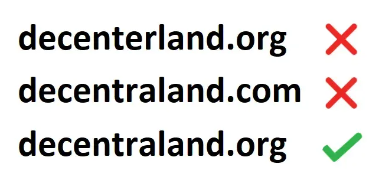

# Seguridad

¿Está bien compartir mi dirección de billetera?

Sí, tu dirección de billetera, una cadena única de números y letras, es como un número de cuenta bancaria. Otros pueden usarla para enviarte regalos, como un Wearable, pero no para quitarte artículos.

Puedes encontrar la dirección de billetera de tu cuenta de Decentraland haciendo clic en tu perfil en el mundo o cuando has iniciado sesión en decentraland.org. Estará debajo del nombre de tu avatar.

Alguien quiere enviarme un artículo gratis—¿es una estafa?

Enviar regalos de Wearables o Emotes es una tradición común en Decentraland, por lo que esto no debería registrarse automáticamente como una señal de alerta. Para que alguien te envíe un regalo, necesitarán tu dirección de billetera, una cadena única de números y letras, pero este dato por sí solo no es algo que pueda usarse para estafarte. Si alguien te envía un regalo usando tu dirección de billetera, debería aparecer en tu Mochila sin ninguna acción necesaria de tu parte.

Lo que **nunca** debes compartir es tu 'frase semilla' (esto aplica si tu cuenta de Decentraland está vinculada a una billetera digital externa).

¿Cuáles son las estafas más comunes a tener en cuenta?

Una de las estafas más comunes son sitios web, cuentas sociales, correos electrónicos y mensajes directos que se hacen pasar por Decentraland y anuncian un airdrop gratuito de MANA. Esto es algo que Decentraland **NUNCA** hará.

Otra táctica común es hacerse pasar por un cliente potencial y enviar un archivo que contiene un virus. Siempre ten mucho cuidado con los mensajes de personas que no conoces personalmente y **nunca** descargues archivos de ellos.

Una buena regla es siempre tomarse el tiempo para verificar las URLs y direcciones de correo electrónico antes de tomar cualquier acción. Los sitios web verdaderos de Decentraland siempre tendrán la base [decentraland.org](http://decentraland.org) y el boletín semanal solo vendrá de hello@decentraland.org.

Lee más sobre [Consejos y Trucos de Seguridad](https://decentraland.org/blog/about-decentraland/how-to-keep-your-digital-assets-safe-in-the-metaverse).

¿Qué debo hacer si mi cuenta/billetera digital ha sido comprometida?

Si desafortunadamente has sido víctima de compromiso de cuenta y notas que tu billetera ha sido vaciada, hay algunas cosas que debes hacer a continuación, dependiendo de cómo ocurrió el hackeo:

* Si tienes activos restantes en tu billetera, puedes intentar transferirlos a una cuenta nueva no comprometida inmediatamente y dejar de usar completamente la billetera comprometida. Crea tu nueva billetera desde un dispositivo diferente en caso de que el virus aún esté presente en tu computadora.
* Si el hackeo ocurrió a través de un archivo descargado, querrás limpiar tu PC completamente para eliminar cualquier malware.
* Independientemente de cómo ocurrió el hackeo, puedes reportar el incidente a tus autoridades locales. Esto no solo puede ayudar con la investigación—dada la legislación local—sino también asistir en la creación de un reporte policial, que puede ser útil para marcar activos comprometidos en plataformas como Opensea.

Después de asegurar tus activos y asegurarte de que tus dispositivos estén limpios, puedes crear una nueva cuenta de Decentraland y volver a explorar.

