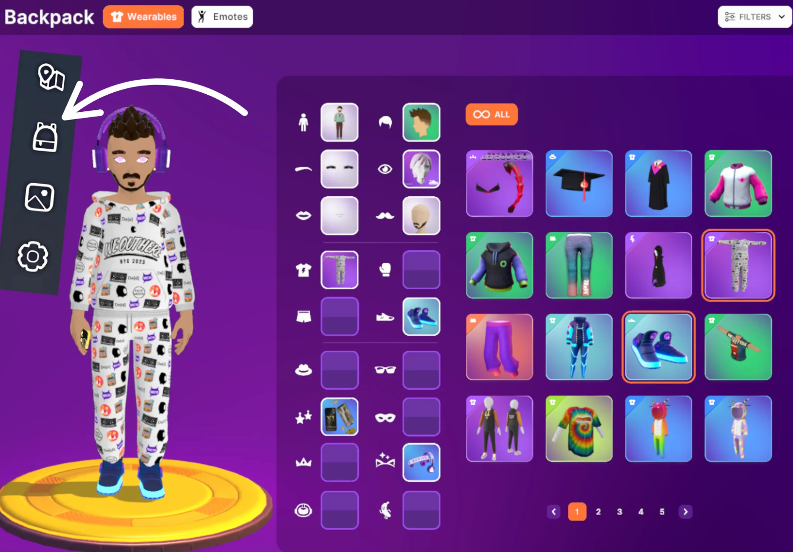
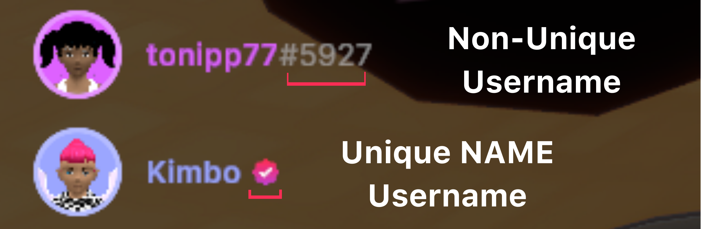
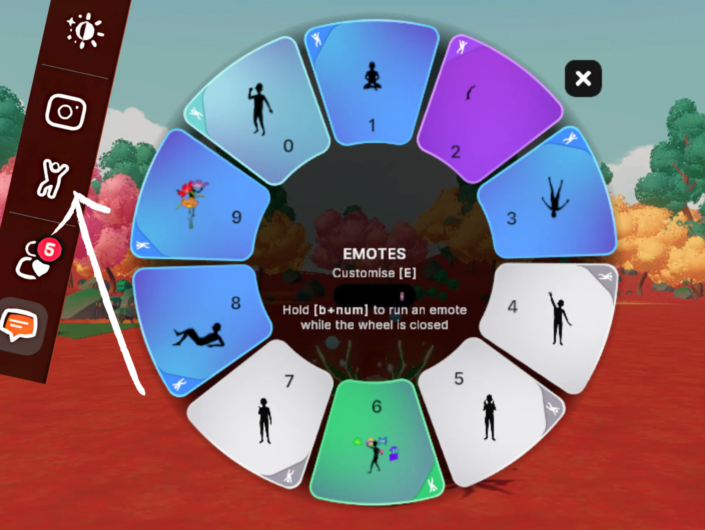
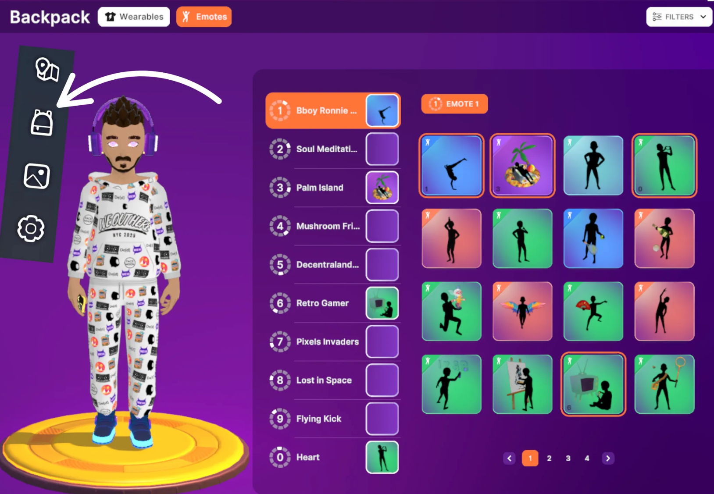

# Personalizar tu Avatar

En Decentraland—con Wearables y Emotes hechos por la comunidad—puedes dar forma a tu avatar para ser _quien sea,_ ya sea la versión más verdadera de ti mismo o tu alter ego oculto.

## Apariencia del Avatar

Edita la apariencia de tu avatar en la Mochila. Busca un ícono de mochila en el menú de la barra lateral. Aquí puedes cambiar las características corporales y el atuendo de tu avatar.

### Obtener Más Wearables

Además de los artículos iniciales gratuitos que siempre están disponibles en tu Mochila, puedes elegir entre miles de Wearables hechos por la comunidad en el Marketplace de Decentraland en [decentraland.org/marketplace](http://decentraland.org/marketplace). Con todo, desde ropa, peinados, pieles completas y más, seguro encontrarás lo que necesitas para crear tu look único. Los artículos comprados aparecerán en tu Mochila en el mundo.

## Nombre de Usuario del Avatar

En Decentraland puedes tener dos tipos de nombres de usuario:

* Uno general, no único que siempre tendrá una cadena aleatoria de números después (por ejemplo, #1234)
* Un nombre de usuario NAME, uno que es único para ti, viene con un montón de ventajas adicionales y tiene un ícono de marca de verificación después en lugar de una cadena de números. Aprende más sobre NAMEs [**aquí**](../faqs/decentraland-101.md#qué-es-un-name).

Siempre puedes editar tu nombre de usuario desde tu Perfil, ya sea editando un nombre de usuario general o aplicando un NAME que posees. [**Reclama tu NAME único**](https://decentraland.org/marketplace/names/claim) ahora o consulta primero un [**tutorial útil**](https://www.youtube.com/watch?v=OKqXmO5fD0s\&ab_channel=Decentraland).

## Emoting con tu Avatar

Los Emotes son animaciones que permiten a tu avatar expresar reacciones, realizar movimientos de baile o participar en actividades como yoga o pintura. Puedes activarlos desde la Rueda de Emotes cuando presionas '**B**' o haces clic en el ícono de figura bailando en el menú de la barra lateral.

## Personalizar tu Rueda de Emotes

La Rueda de Emotes tiene 10 ranuras para diferentes Emotes. Puedes personalizar qué Emotes aparecen allí desde tu Mochila.

### Obtener Más Emotes

Al igual que los Wearables iniciales en tu Mochila, tu avatar siempre tendrá los Emotes básicos gratuitos disponibles para todos, pero hay aún más Emotes hechos por la comunidad esperando ser descubiertos en el Marketplace de Decentraland en [decentraland.org/marketplace](http://decentraland.org/marketplace). Cualquier Emote que compres aparecerá en tu Mochila en el mundo.
