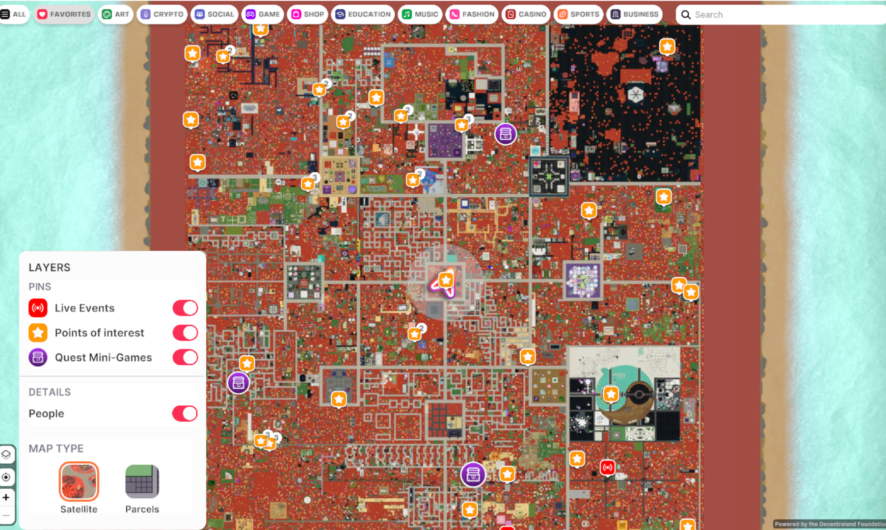
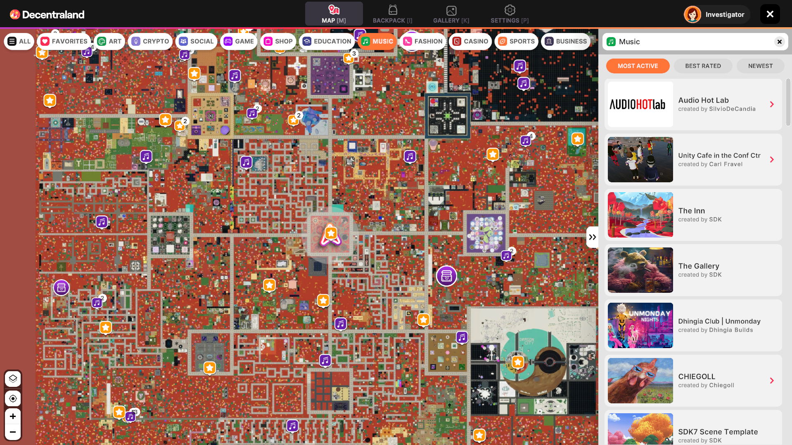
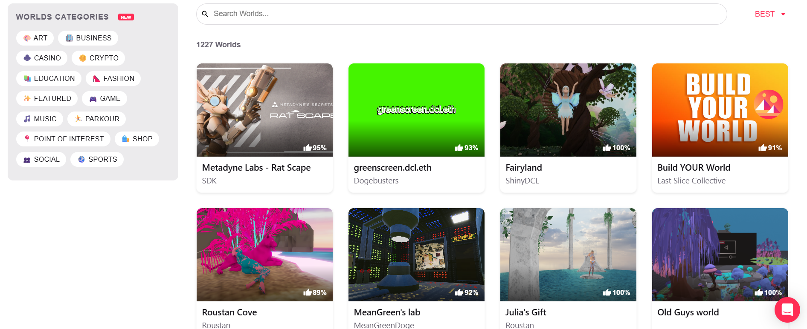
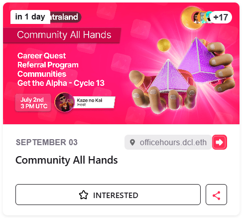

# Explorando

Decentraland está completamente compuesto por contenido generado por la comunidad. Cuando estás explorando, nunca sabes lo que podrías descubrir—¡ya sea en el mapa de Genesis City o en el World de alguien! Las opciones pueden sentirse abrumadoras, así que aquí hay algunos consejos para aprovechar al máximo tu aventura.

Aprende más sobre la diferencia entre Genesis City y Worlds [**aquí**](overview.md#genesis-city-vs-worlds-el-paisaje-de-decentraland-explicado).

## Explorar Genesis City

Con miles de parcelas propiedad de la comunidad para cruzar en Genesis City, simplemente caminar en línea recta es su propia aventura. Sin embargo, si deseas ser más preciso en tu exploración, encontrarás que el Mapa es muy útil.

### **Usar el Mapa para Descubrir**

El Mapa se puede abrir haciendo clic en el Mini Mapa en la esquina superior izquierda de tu pantalla o haciendo clic en el ícono del Mapa en el menú de la barra lateral.

### **Capas y Pines**

Mirando la imagen satelital de Genesis City, notarás muchos íconos diferentes. **Para cambiar el tipo de mapa y alternar pines de ubicación**, haz clic en el ícono de capas en la parte inferior izquierda del mapa.

Los pines rojos de '**Eventos en Vivo**' muestran la ubicación de un evento que está sucediendo actualmente. Haz clic en el ícono para ver más sobre el evento y haz clic en 'Entrar' para teletransportarte a su ubicación.

Los pines amarillos de '**Puntos de Interés**' marcan ubicaciones que la comunidad consideró imperdibles—podrían ser cualquier cosa, desde un juego hasta una obra de arte impresionante. Hacer clic en el ícono mostrará una descripción y un botón 'Entrar' para teletransportarte directamente.

### **Categorías de Ubicación**

Descubre ubicaciones interesantes en Decentraland basadas en categorías. Cuando abres el mapa, verás una variedad de burbujas de Categoría en la parte superior de la pantalla, incluyendo temas como Arte, Música, Juegos, etc.

Haz clic en una categoría para mostrar pines que marcan las ubicaciones etiquetadas con esa categoría. Hacer clic en uno abrirá una tarjeta de información con una descripción y un botón 'Entrar' para que puedas teletransportarte directamente a la escena.

### **Teletransportarse a Parcelas Específicas**

En el mundo, puedes saltar directamente a una parcela específica usando el **Mapa** o **Comandos de Chat**.

* **Teletransportación vía Mapa:** Hacer clic en cualquier ubicación en el Mapa mostrará una tarjeta de información sobre la ubicación, incluso si es una parcela vacía. Esta tarjeta también tendrá un botón 'Entrar' que te teletransportará al lugar.
* **Teletransportación vía Comando de Chat:** Si conoces las coordenadas de la parcela a la que quieres saltar, pon el siguiente comando en el cuadro de chat Cercano (en la parte inferior izquierda de tu pantalla) y presiona \[**Enter**].
  * `/goto x,y` (por ejemplo, `/goto 0,0` para Genesis Plaza)
    * Aprende más sobre Comandos de Chat [**aquí**](shortcuts-and-chat-commands.md#comandos-de-chat).

## Explorar Worlds

En contraste con Genesis City, los **Worlds** son espacios virtuales más íntimos, como islas personales ubicadas fuera del mapa de Decentraland. Solo se pueden visitar mediante teletransportación.

### Descubrir Nuevos Worlds

Aunque los Worlds tienden a ser más privados, puedes descubrirlos navegando por Worlds listados en la [**página de Places**](https://decentraland.org/places/worlds/) y asistiendo a eventos organizados en Worlds.

Más de 1K propietarios de Worlds eligen listar públicamente sus Worlds en la página de Places, haciéndolos más fáciles de descubrir. Navega a través de ellos y filtra por categorías para encontrar el World perfecto para tu aventura diaria.

Los eventos también se pueden organizar en Worlds—¡asistiéndolos puedes hacer amigos y explorar! A continuación se muestra un ejemplo de un evento organizado en un World. Por la flecha roja de 'entrar', puedes ver el nombre del World en lugar de coordenadas de Genesis City.

### Teletransportarse a un World

Si conoces el nombre de un World, puedes teletransportarte a él usando un **Comando de Chat**. Simplemente pon el siguiente comando en el cuadro de chat Cercano (en la parte inferior izquierda de tu pantalla) y presiona \[**Enter**].

* `/goto NombreDelWorld` (por ejemplo, `/goto officehours`)
  * Aprende más sobre Comandos de Chat [**aquí**](shortcuts-and-chat-commands.md#comandos-de-chat).
