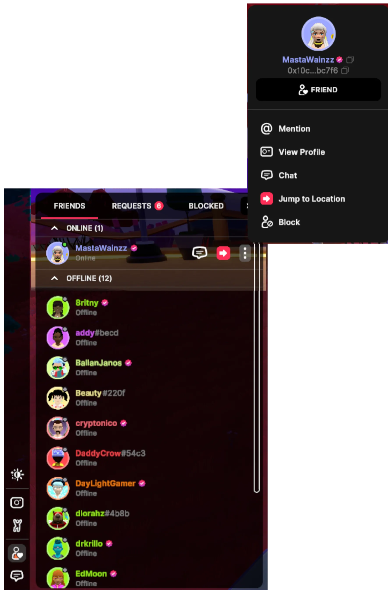
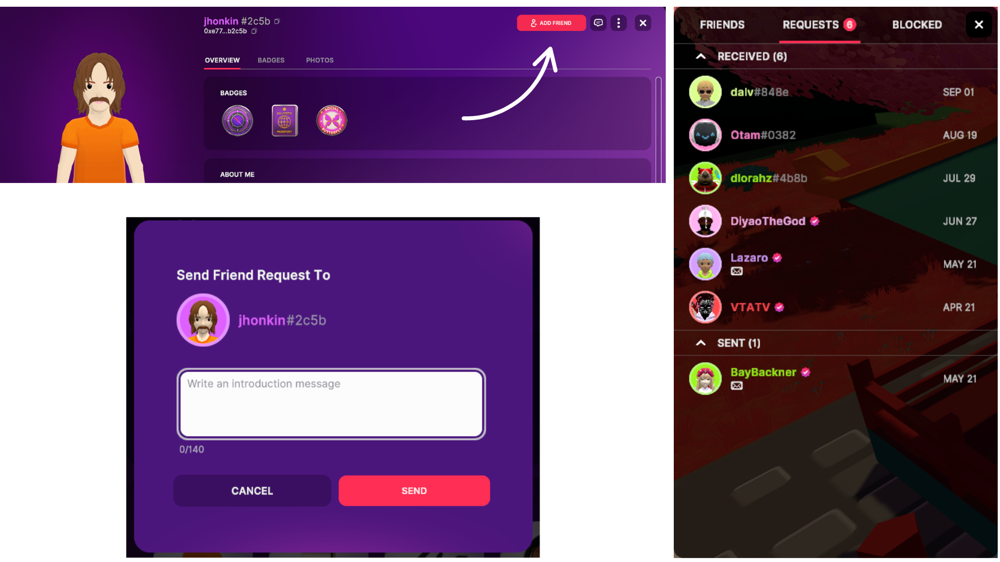
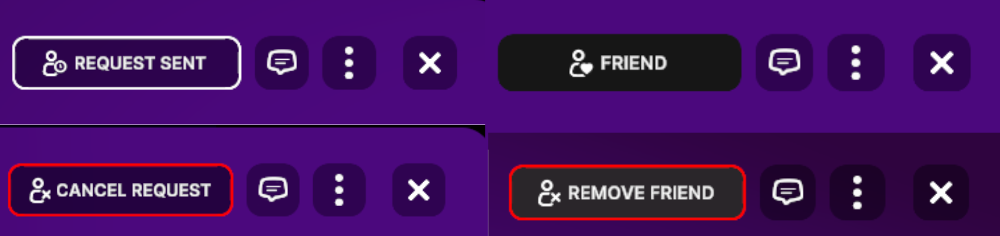
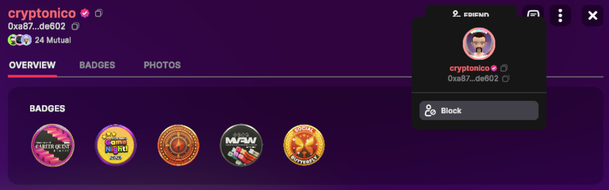
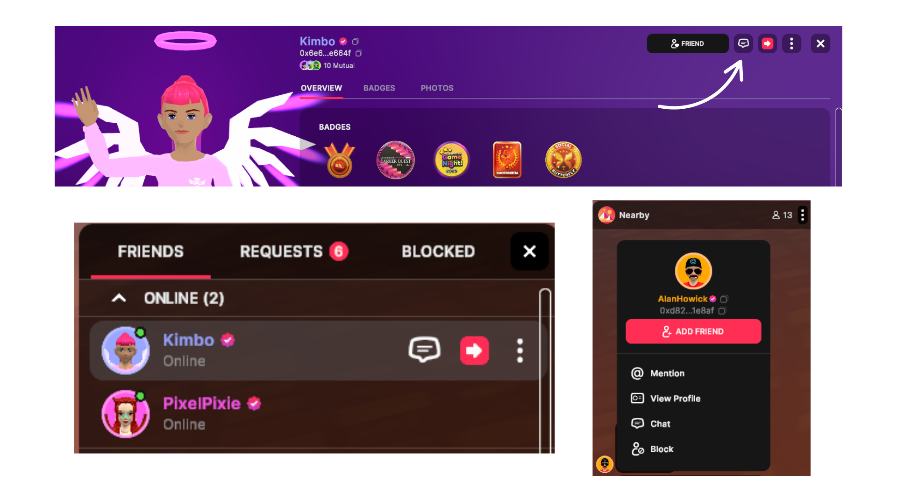
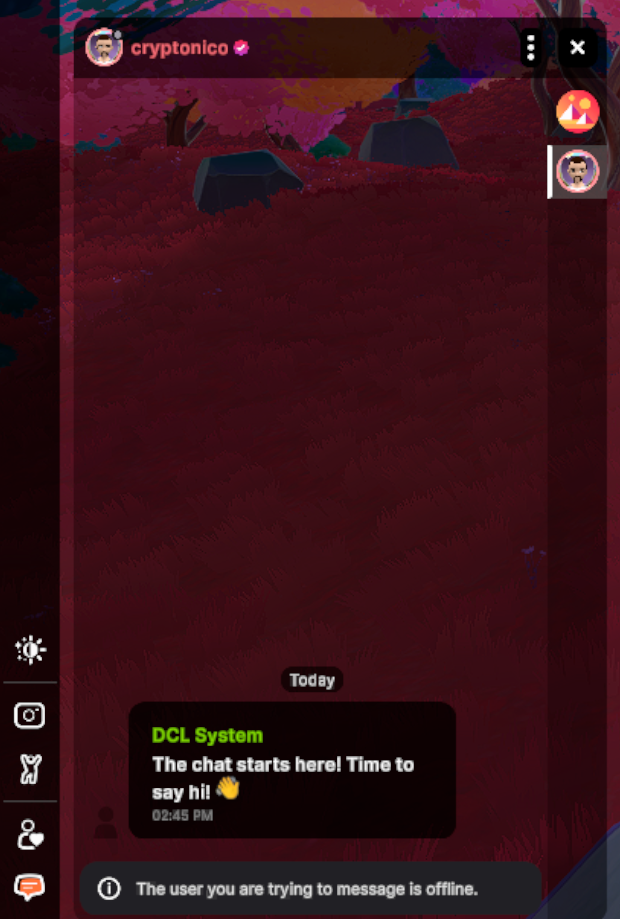
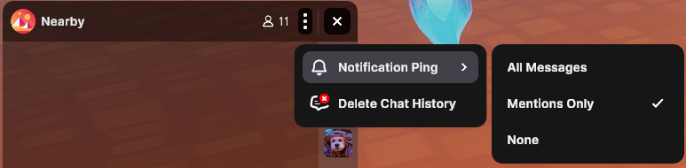

# Amigos y Chat

Decentraland se trata de reunir a personas de todo el mundo. Hacer amigos y chatear es clave para sentirse parte de la comunidad del mundo virtual. Aquí aprenderás cómo gestionar tus amistades y chats.

## Gestión de Amistades

El ícono de Amigos vive en la parte inferior izquierda de tu pantalla y es el hogar de tu Lista de Amigos, Solicitudes de Amistad y cuentas Bloqueadas.

### **Lista de Amigos**

Pasar el cursor sobre el nombre de un Amigo hará que aparezcan otras opciones. Si tu amigo está en línea, puedes chatear o saltar a su ubicación. Si haces clic en los tres puntos junto a su nombre, puedes acceder a su menú personal.

### **Solicitudes de Amistad**

Para enviar una solicitud de amistad a alguien, abre su perfil (pasar el mouse sobre cualquier avatar mostrará la opción 'Ver Perfil'). En la esquina superior derecha de la tarjeta de perfil, verás un botón rojo 'Agregar Amigo'. Después de seleccionarlo, tendrás la opción de agregar un mensaje a tu solicitud de amistad antes de enviarla.

Consulta las solicitudes que has enviado y recibido en la pestaña 'Solicitudes' de tu interfaz de Amigos. Las solicitudes con un ícono de sobre tienen un mensaje adjunto. Léelo haciendo clic en el sobre.

Para cancelar una solicitud o dejar de ser amigo de alguien, usarás el mismo botón en su perfil, ya que cambia en relación con tu estado con alguien. Pasar el cursor sobre el botón mostrará la opción de cancelar solicitudes o dejar de ser amigos.

## Bloquear Cuentas

Si bloqueas a un jugador en Decentraland, ya no verás su avatar en el mundo, y no podrán enviarte solicitudes de amistad o mensajes. Tampoco verán los mensajes de cada uno en chats públicos o privados.

**Cómo Bloquear a un Jugador**

Para bloquear a un jugador, abre su tarjeta de perfil haciendo clic en su avatar y haz clic en los tres puntos en la esquina superior derecha sobre su imagen de avatar, luego selecciona la opción 'Bloquear'. También puedes bloquear a alguien dentro de un chat haciendo clic en su nombre para abrir su menú personal y seleccionando 'Bloquear'.

**Cómo Desbloquear a un Jugador**

Las cuentas bloqueadas aparecen en una pestaña separada de tu interfaz de 'Amigos'. Pasar el cursor sobre el nombre de alguien en esta sección revelará el botón 'Desbloquear'.

## Chats

En Decentraland, la principal línea de comunicación es el chat basado en texto. En el mundo, siempre puedes ver una barra de chat en la parte inferior izquierda de tu pantalla. Aquí es donde puedes enviar mensajes directos a amigos (o a cualquiera dependiendo de la configuración seleccionada) y chatear con las personas a tu alrededor a través del Chat Cercano.

### Chat Cercano

Identificable por el ícono de Decentraland, el Chat Cercano es donde puedes chatear con las personas a tu alrededor en el mundo, incluso si no son amigos. Siempre estará listado en la parte superior de tu lista de chats. El Chat Cercano también se puede usar para ingresar comandos de Chat que solo tú verás—aprende más [**aquí**](shortcuts-and-chat-commands.md#chat-commands).

### Chats Privados

La opción de comenzar a chatear con alguien se puede acceder desde su Perfil o menú personal. Si son amigos, un ícono de chat también aparecerá junto a su nombre en tu Lista de Amigos. Sin embargo, ten en cuenta que, fuera de las amistades, a quién puedes enviar y recibir mensajes directos dependerá de la configuración de chat de ambas partes.

Ten en cuenta también que los mensajes solo se pueden enviar a jugadores que están actualmente en línea.

### Configuración de Chat

Dentro de tu Configuración en el mundo, verás una pestaña de Chat.

**Permisos de Mensajes Directos**

Hay dos opciones cuando se trata de seleccionar a quién quieres poder enviar y recibir mensajes directos:

* **Solo Amigos:** Solo podrás enviar y recibir mensajes privados de Amigos
* **Todos:** Los jugadores que seleccionen esta opción podrán enviarse mensajes privados entre sí, incluso si no son amigos.

**Notificaciones de Ping**

Si tienes tu sonido activado, tienes la opción de recibir un ping de notificación para chats seleccionados. Puedes establecer tus preferencias desde cada chat individual haciendo clic en los 3 puntos en la parte superior derecha de un cuadro de chat. Desde la Configuración de Chat principal, puedes seleccionar la configuración para todos tus chats simultáneamente.

**Burbujas de Chat**

Puedes notar burbujas de chat apareciendo sobre los avatares cuando estás en el mundo. Actualmente, puedes elegir ver burbujas de chat para ningún chat, todos los chats o solo el Chat Cercano. Las burbujas de chat de chats privados solo pueden ser vistas por los participantes del chat.
