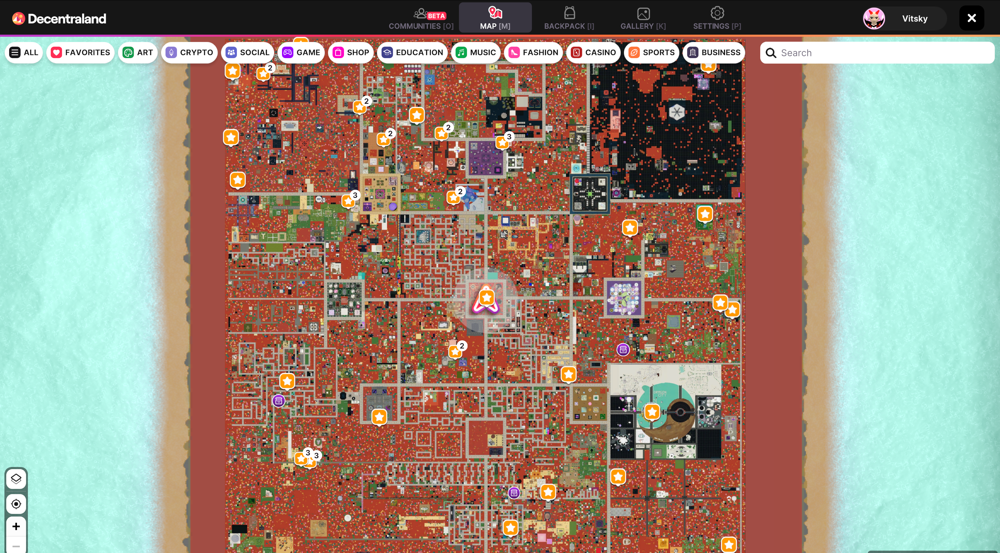

# Resumen

**'En el Mundo'** se refiere a cualquier cosa que suceda dentro del mundo virtual de Decentraland—¡aquí es donde ocurre la magia!

La masa terrestre principal de Decentraland, Genesis City.

## **Cómo Entrar a Decentraland**

Para entrar al mundo virtual, primero debes descargar [la aplicación de escritorio de Decentraland](https://decentraland.org/download/). Una vez que la hayas instalado e iniciado sesión en tu cuenta de Decentraland, puedes comenzar a explorar Genesis City de Decentraland (en la imagen de arriba), y su archipiélago de Worlds fuera del mapa.

## Genesis City vs. Worlds: El Paisaje de Decentraland Explicado

**Genesis City** es la masa terrestre principal de Decentraland, visible en el mapa del mundo virtual. Está compuesta por miles de parcelas LAND propiedad de la comunidad, cada una de 16m x 16m de tamaño, y comercializadas en [el Marketplace de Decentraland](https://decentraland.org/marketplace/lands). Como la ciudad está distribuida en una cuadrícula masiva de cuatro cuadrantes, cada parcela se referencia por un conjunto de coordenadas—en el centro (0,0), se encuentra el punto de aparición predeterminado de Decentraland: Genesis Plaza.

A pesar de ser un mosaico de parcelas de propiedad individual, Genesis City es única en su apertura y transitabilidad. Si buscas una aventura, ¡solo camina por el mapa—siempre hay algo nuevo que descubrir de la comunidad global de Decentraland!

En contraste con las parcelas LAND de Genesis City, los **Worlds** son espacios virtuales más íntimos, como islas personales ubicadas fuera del mapa de Decentraland. Aunque no puedes caminar hacia ellos, puedes teletransportarte a un World si conoces su nombre o tienes un enlace de invitación. Desbloquea tu propio World [obteniendo un NAME de Decentraland](https://decentraland.org/marketplace/names/claim). Es tu espacio para usar como desees—configúralo como privado o público, organiza eventos o practica tus habilidades de construcción. Aprende más sobre NAMEs [aquí](../faqs/decentraland-101.md#que-es-un-name).

Aprende más sobre cómo explorar y navegar por Decentraland [**aquí**](exploring.md).
