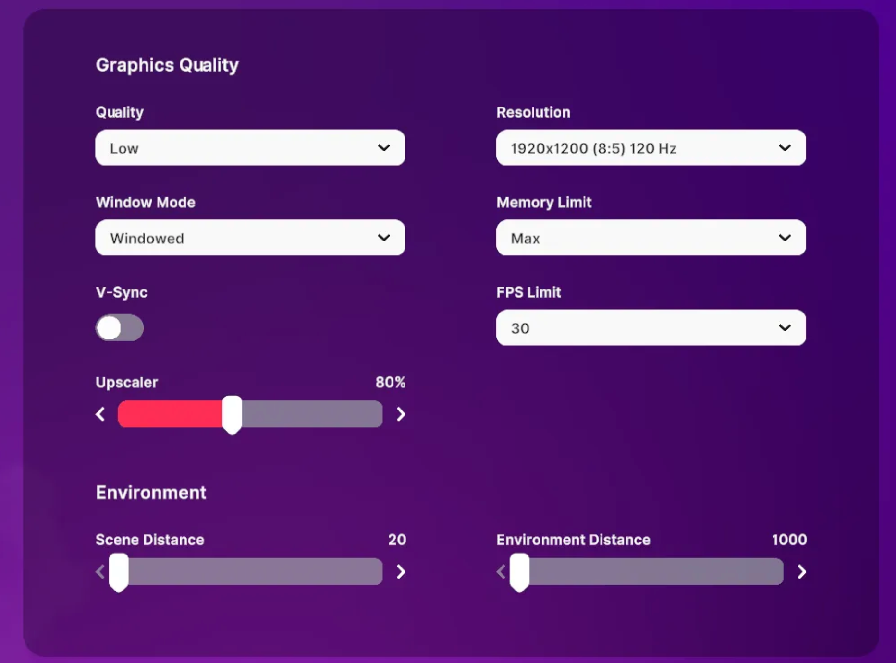
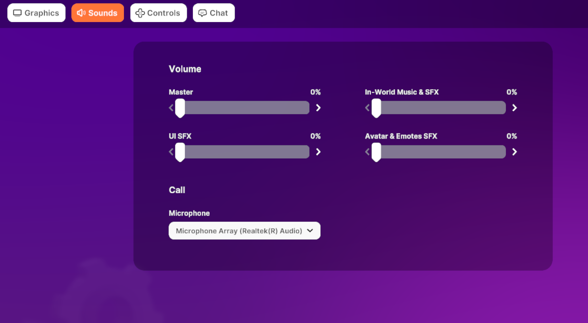
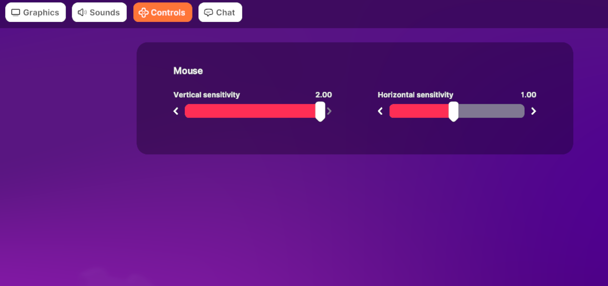
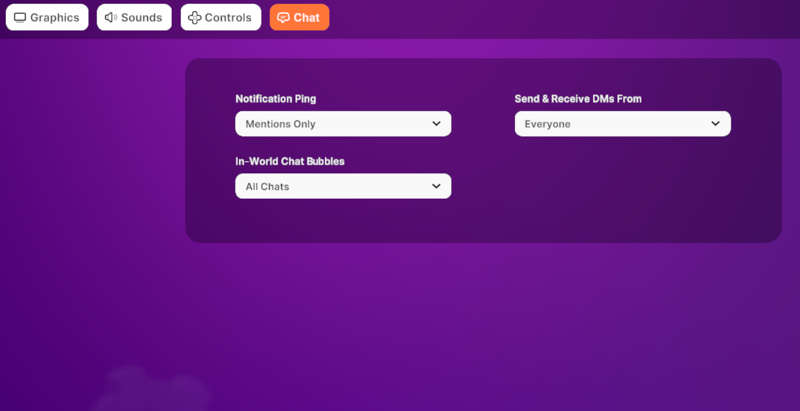

# Configuración y Rendimiento

Cuando estés en el mundo, busca el ícono de engranaje en el menú de la barra lateral para acceder a la configuración de Gráficos, Sonido, Control y Chat.

## Optimizar el Rendimiento de Decentraland en tu Dispositivo

Renderizar el mundo abierto de Decentraland requiere un cierto nivel de potencia técnica. Si tu computadora no cumple con los requisitos mínimos enumerados a continuación, puedes experimentar un rendimiento deficiente y tiempos de carga largos. En este escenario, puedes intentar optimizar el rendimiento de Decentraland bajando tu configuración de Gráficos en el mundo.

### **Windows**

|         | Mínimo Requerido                                                       | Configuración Recomendada                        |
| ------- | ---------------------------------------------------------------------- | ------------------------------------------------ |
| SO      | Windows 10 64-bit                                                      | Windows 11 64-bit                                |
| CPU     | Intel i5 7ª generación o AMD Ryzen 5 Series                            | Intel i7 12ª generación o AMD Ryzen 7 Series     |
| GPU     | Nvidia RTX 20 Series o AMD Radeon RX 5000 Series (compatible DirectX 12) | Nvidia RTX 30 Series o AMD Radeon RX 6000 Series |
| VRAM    | 6 GB                                                                   | 12 GB                                            |
| RAM     | 16GB                                                                   | 32 GB                                            |
| Almacen | 8GB HDD                                                                | 20GB SDD                                         |

### **Mac**

|         | Mínimo Requerido                                       | Configuración Recomendada      |
| ------- | ------------------------------------------------------ | ------------------------------ |
| SO      | macOS 11 Big Sur                                       | macOS 12 Monterey              |
| CPU     | Apple M1                                               | Apple M1 Pro/M2                |
| GPU     | Apple M1 GPU integrado (soporte Metal requerido)       | Apple M1 Pro/M2 Pro GPU integrado |
| VRAM    | 6 GB                                                   | 12 GB                          |
| RAM     | 16GB                                                   | 32 GB                          |
| Almacen | 8GB HDD                                                | 20GB SDD                       |

### Ajustar Configuración de Gráficos

Si tu computadora no cumple con todos los requisitos mínimos de hardware de Decentraland, puedes intentar optimizar tu experiencia bajando tu configuración de gráficos en el mundo. Aquí están las configuraciones para el mejor rendimiento:

## Configuración de Sonido

Modifica el volumen de sonidos individuales para personalizar tu experiencia en Decentraland:

* **Master:** Afecta todos los sonidos
* **SFX de IU:** Afecta la música que se reproduce cuando inicias sesión en Decentraland
* **Música y SFX en el Mundo:** Afecta música, audio de streams y cualquier otro efecto de sonido generado por una escena
* **SFX de Avatar y Emotes:** Afecta sonidos de avatares y Emotes con efectos de sonido

## Configuración de Control

Aquí puedes modificar la sensibilidad de tu mouse en el mundo.

## Configuración de Chat

Desde la configuración principal, puedes modificar las preferencias de notificaciones y burbujas de chat para todos tus chats simultáneamente, así como tus permisos de mensajes directos. Consulta la sección [**Chat**](friends-and-chatting.md#configuración-de-chat) para un desglose completo.

