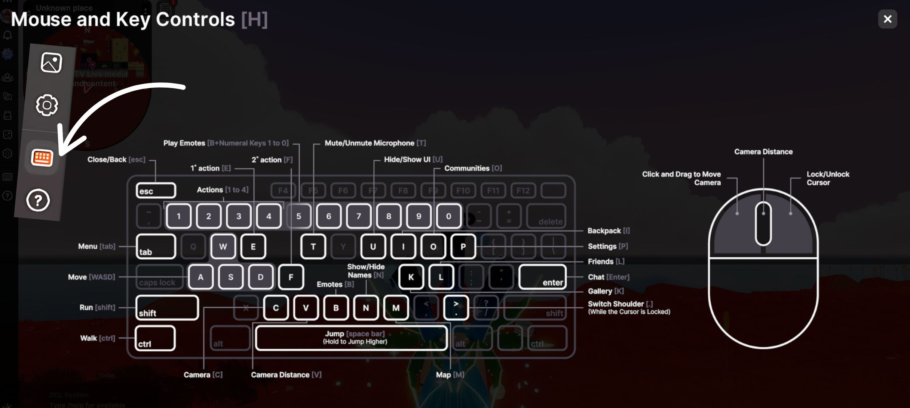
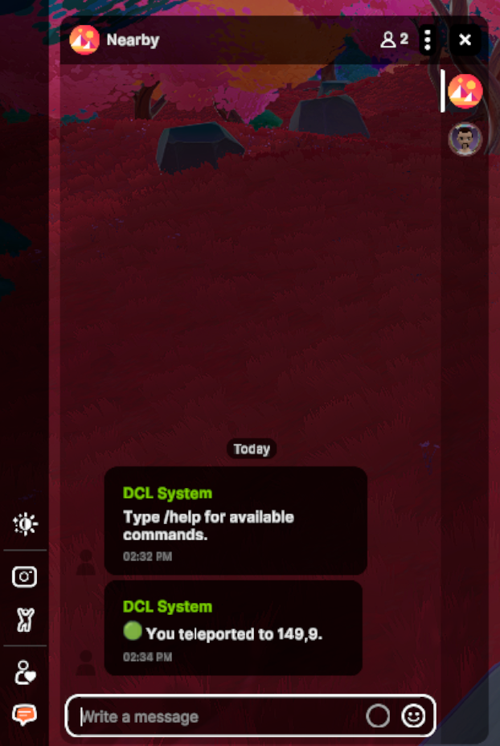

# Atajos y Comandos de Chat

## Atajos de Teclado

Además de usar las teclas WASD o de flechas para mover tu avatar por Decentraland, tu teclado puede hacer mucho más por ti cuando estás en el mundo. Todos los atajos de teclado se muestran arriba. Puedes ver este gráfico en el mundo cuando lo necesites, solo haz clic en el ícono del teclado en el menú de la barra lateral.

**Recuerda estos atajos:**

* \[**B**]: Abrir Rueda de Emotes
* \[**Shift**]: Correr mientras te mueves
* \[**C**]: Abrir Cámara
* \[**K**]: Abrir Galería de Fotos
* \[**U**]: Mostrar/Ocultar IU
* \[**N**]: Mostrar/Ocultar etiquetas de nombres

## Comandos de Chat

Cuando estás en el mundo, siempre puedes ver una barra de chat en la esquina inferior izquierda de tu pantalla. Aquí es donde puedes acceder a chats con tus amigos, así como al **Chat Cercano**. Identificable por el ícono de Decentraland, el Chat Cercano es donde puedes chatear libremente con personas a tu alrededor en el mundo, incluso si no son amigos. El Chat Cercano también se puede usar para ingresar comandos de Chat que solo tú verás.

Los comandos de chat son cadenas específicas de texto utilizadas para activar acciones, como teletransportarse o recargar. Para usar uno, escribe el comando en el Chat Cercano y presiona \[**Enter**].

* **Teletransportarse por Genesis City** `/goto x,y` (por ejemplo, `/goto 0,0` para Genesis Plaza)
* **Visitar Worlds** `/goto NombreDelWorld` (por ejemplo, `/goto officehours`)
* **Recargar una Escena** `/reload`
* **Abrir Modo Debug (muestra FPS y otras métricas)** `/debug`
* **Descubrir Más Comandos de Chat** `/help`

