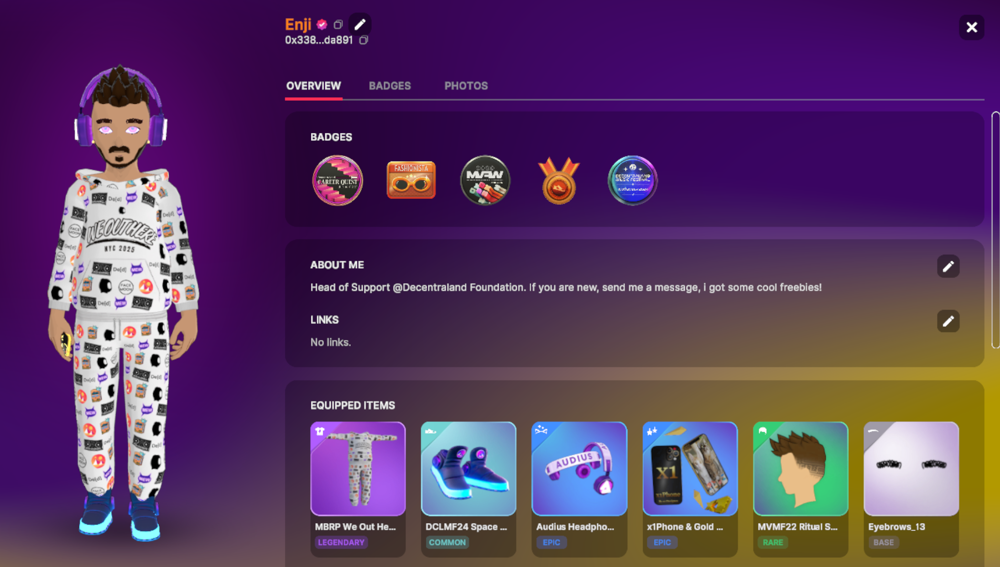
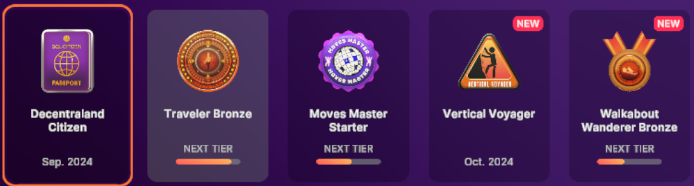
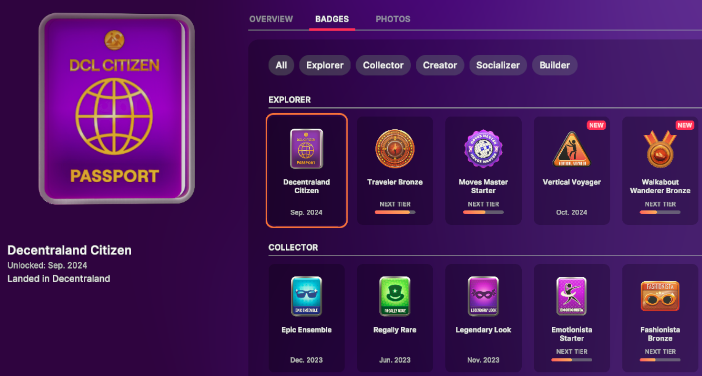
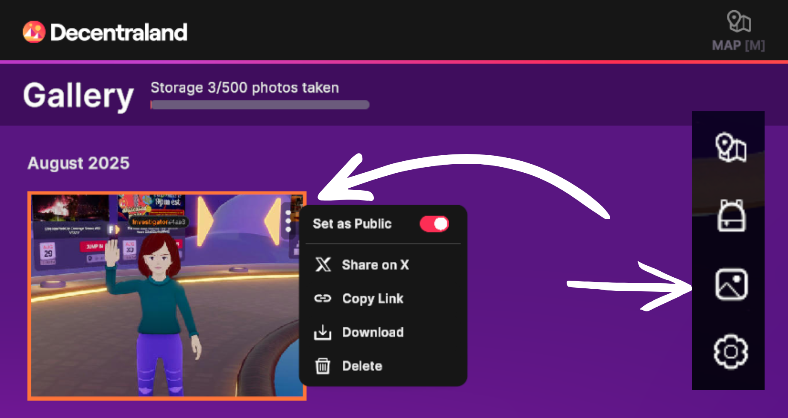

# Tu Perfil

En el mundo, tu perfil ayuda a otros a conocer quién eres. Cuando pasas el cursor sobre el avatar de alguien, aparecerá la opción 'Ver Perfil'. Para ver y editar tu propio perfil, haz clic en tu foto de perfil, ubicada en la parte superior del menú de la barra lateral, a la izquierda de tu pantalla.

Verás un ícono de lápiz junto a los componentes del Perfil que puedes editar, como tu nombre de usuario y la sección 'Sobre Mí'. Escribir un poco sobre ti y tus intereses puede facilitar hacer amigos, pero ten cuidado de no compartir información personal sensible.

## Badges

Los Badges son una forma divertida de celebrar tus logros y actividades en Decentraland. ¡También pueden decir mucho sobre ti!

Consulta la pestaña de Badges de tu perfil para ver tu progreso de Badges y lo que necesitas hacer para desbloquear un nuevo Badge o el siguiente nivel de un Badge que ya has ganado.

 

## Fotos

Ayuda a otros a conocerte compartiendo tus fotos favoritas de tu tiempo en Decentraland.

**Cómo agregar una foto a tu Perfil:**

1. Abre tu Galería de Fotos haciendo clic en el ícono de Imagen en el menú de la barra lateral. Cualquier foto que hayas tomado con la Cámara en el mundo aparecerá aquí.
2. Haz clic en los 3 puntos en la esquina superior derecha de la foto que quieres compartir en tu perfil
3. Activa 'Establecer como Público' a la posición encendida

¡Listo! Cualquier foto marcada como Pública aparecerá en tu Perfil. Para eliminar una foto, simplemente desactiva la configuración Pública.

