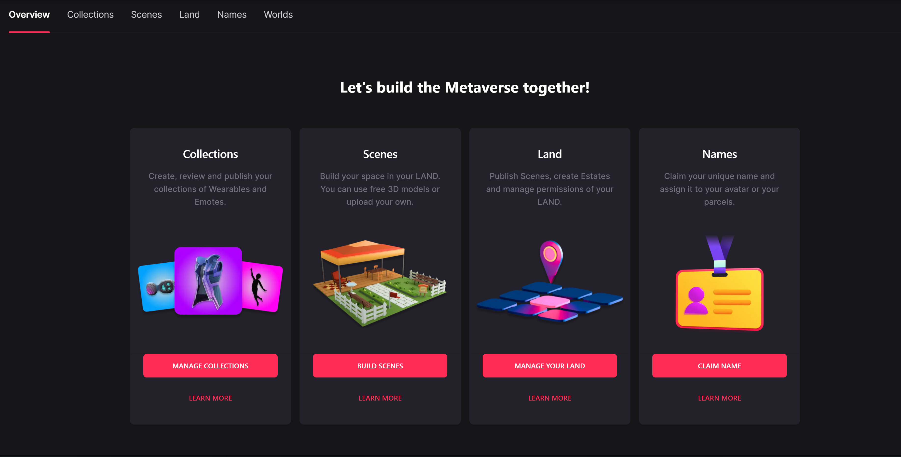
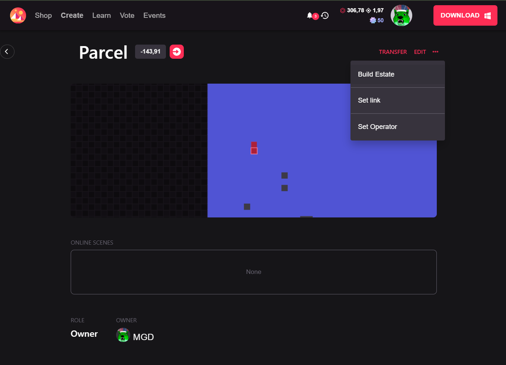
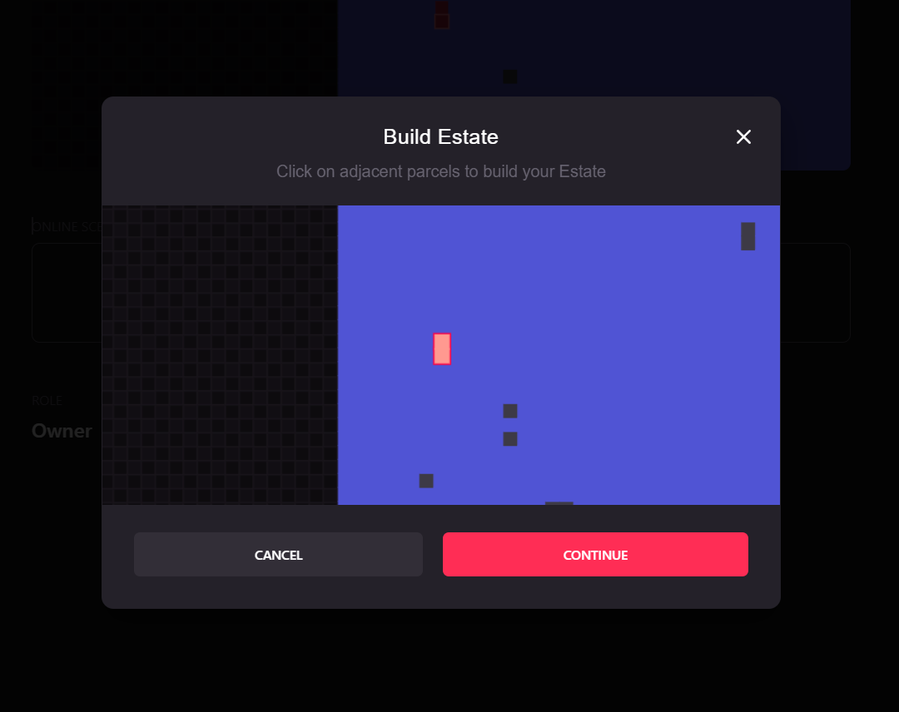
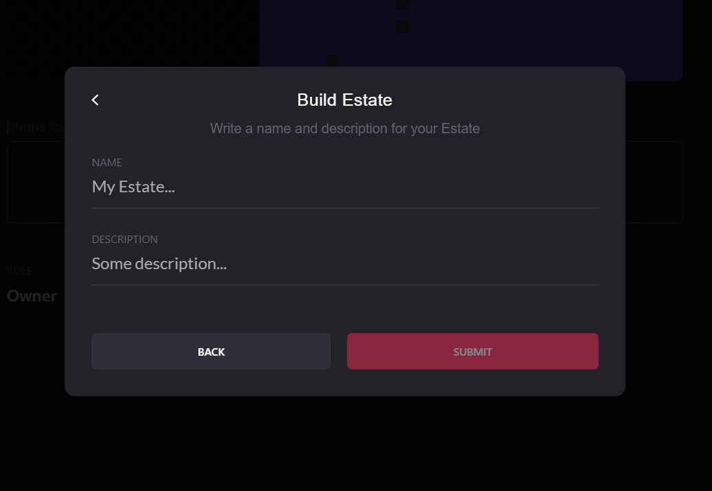
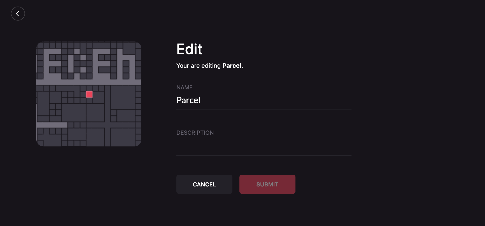
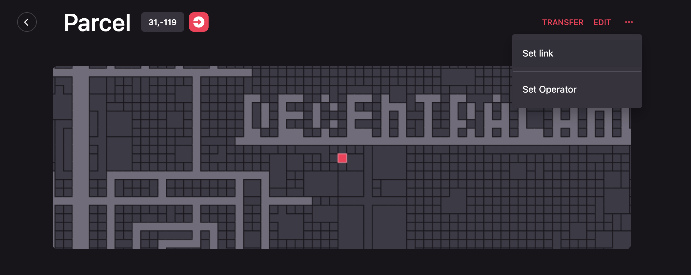
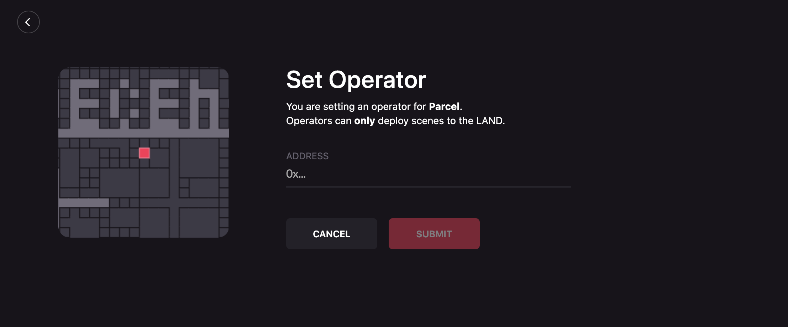
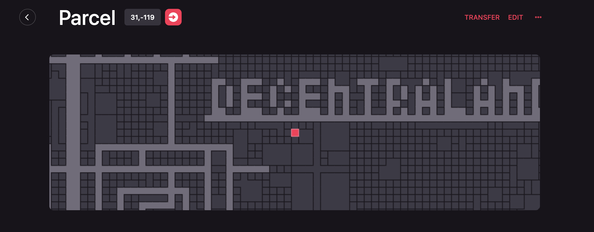
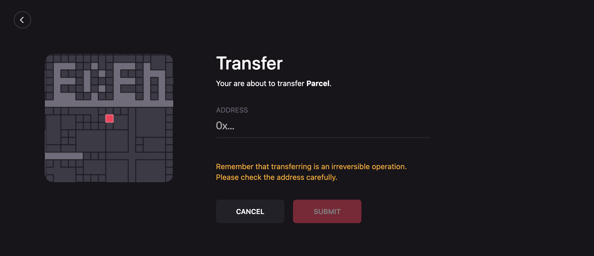

# Gestor de LAND

El Gestor de Land te permite gestionar tus activos LAND y Estate.

Accede al Gestor de Land en [https://builder.decentraland.org/land](https://builder.decentraland.org/land).

El Gestor de Land te permite:

* **Nombrar** tus parcelas y Estates y darles una descripción pública.
* **Fusionar** parcelas LAND en un Estate.
* **Disolver** un Estate en parcelas LAND separadas.
* **Transferir** tus parcelas y Estates a otro usuario.
* **Otorgar permisos** a otros usuarios para editar las parcelas que posees.

## Gestionar tu LAND

Para ver tus tokens LAND, haz clic en **Gestionar tu LAND**. Aquí encontrarás una lista de todas tus parcelas y Estates, incluyendo cualquier parcela que hayas listado para venta.

Al hacer clic en una de las parcelas o Estates listados bajo **Land**, puedes editar su nombre, descripción, establecer un operador o transferirla directamente a otra dirección de billetera.

## Crear un Estate

Los Estates LAND hacen posible asociar dos o más parcelas directamente adyacentes de LAND para facilitar la gestión de tus propiedades LAND más grandes. Los Estates son especialmente útiles al construir escenas más grandes que abarcan más de una parcela.

Las parcelas en un Estate deben ser directamente adyacentes y no pueden estar separadas por una carretera, plaza o cualquier otra parcela.

Para crear tu primer Estate, necesitas poseer dos o más parcelas LAND adyacentes.

1. Abre **Mi LAND** y selecciona una de las parcelas que deseas agregar al Estate.
2. En la página de detalles de la parcela, haz clic en **Crear Estate**.
3. Se te mostrará una vista del Atlas centrada en la parcela que seleccionaste, con las parcelas adyacentes restantes que posees resaltadas. Selecciona las diferentes parcelas que deseas incluir en tu Estate.  
4. Haz clic en **Continuar**.
5.  Ingresa un nombre y descripción para tu Estate. Estos detalles se mostrarán públicamente en el Atlas, al igual que el nombre y la descripción de cualquier parcela individual.

    
6. Confirma esta transacción en tu cliente de Ethereum y espera a que la red la verifique.

Una vez que hayas creado tu primer Estate, verás una nueva pestaña titulada Estates. Desde esta página puedes ver y gestionar todos tus Estates.

Cuando creas un nuevo Estate, efectivamente estás transfiriendo tus parcelas a un nuevo token. Estos Estates están representados por tokens ERC721 (como cualquier otro NFT). Ya no verás las parcelas individuales bajo _Mi LAND_, y no aparecerán en billeteras MetaMask, Mist, Trezor o Ledger, ni en Etherscan bajo tu dirección.

## Editar parcelas o Estates

Puedes editar el nombre y la descripción de cualquier parcela o Estate que poseas. Estos detalles se mostrarán públicamente en el Atlas.

Para editar una parcela o Estate:

1.  Navega a la página de detalles de la parcela o el Estate que deseas editar y haz clic en **Editar**.

    
2. Haz clic en **Enviar**.
3. Confirma esta transacción en tu cliente de Ethereum y espera a que la red la verifique.

## Dar permisos

Puedes dar a otro usuario permisos para editar el contenido en una parcela o Estate. Esto habilita a ese usuario para desplegar código en la escena, sin tener la capacidad de vender el token.

El usuario con permisos también puede cambiar el nombre o descripción en el Marketplace.

Para otorgar permisos sobre tu LAND:

1. Navega a la página de detalles de la parcela o Estate y haz clic en los tres puntos y luego en **Establecer Operador**. 
2.  Completa el formulario con la información deseada.

    
3. Haz clic en **Enviar**.
4. Confirma esta transacción en tu cliente de Ethereum y espera a que la red la verifique.

## Ver tu historial de actividad

Abre la página de notificaciones haciendo clic en el ícono de campana en la parte superior de la pantalla.

La página de notificaciones muestra una lista de todas las transacciones recientes que has realizado, junto con su estado.

Haz clic en una transacción para ver más detalles sobre ella en Etherscan.

## Transferir LAND

Para transferir una parcela LAND o Estate a otro usuario:

1.  Navega a la página de detalles de la parcela o el Estate que deseas transferir y haz clic en **Transferir**.

    
2. Ingresa la dirección pública de la billetera Ethereum del destinatario.


**📔 Nota**: Por favor verifica dos veces esta dirección, ya que no puedes cancelar la operación. Aunque el destinatario siempre podría transferir el LAND de vuelta a ti, el propietario original no puede revertir la acción.


3. Haz clic en **Enviar**.
4. Confirma esta transacción en tu cliente de Ethereum y espera a que la red la verifique.
