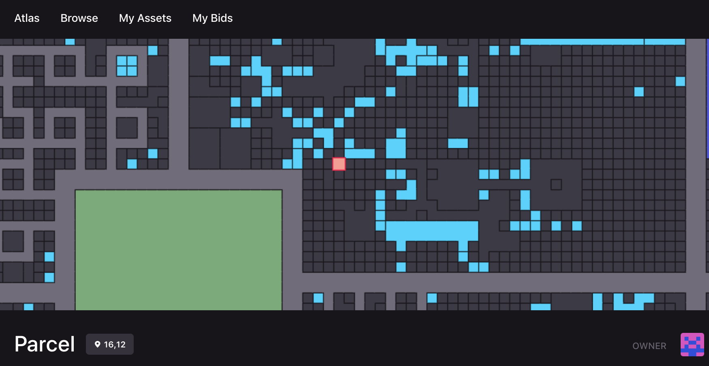

# Marketplace

El Marketplace es el lugar ideal para comerciar y gestionar todos tus activos de Decentraland como Wearables, Emotes, LAND y más.

Accede al Marketplace en [https://decentraland.org/marketplace/](https://decentraland.org/marketplace/).

El Marketplace te permite:

* **Vender** parcelas y Estates de LAND, Wearables, Emotes y NAMEs únicos. Establece tu propio precio en MANA y una fecha de vencimiento para el listado.
* **Comprar** parcelas y Estates, Wearables, Emotes y NAMEs únicos en venta.
* **Transferir** tus activos de Decentraland a otro usuario.

## Iniciar Sesión

Puedes navegar libremente por el Marketplace sin necesidad de iniciar sesión, pero se recomienda iniciar sesión mientras navegas por el Marketplace para una experiencia mejorada. Si deseas iniciar sesión, puedes usar cualquiera de las opciones disponibles como Gmail, Discord o usando Wallets como Metamask.


**📔 Nota**: Si deseas usar tu billetera de hardware Ledger en el Marketplace, requerirá que la conectes a MetaMask. Por favor asegúrate de seguir todos los [pasos dados](https://support.metamask.io/more-web3/wallets/how-to-connect-a-trezor-or-ledger-hardware-wallet/) y actualizaciones para permitir un uso sin problemas de Ledger.


## Vista de Mapa de LANDs

La vista de Atlas te da una perspectiva aérea de cada parcela, Estate, carretera, distrito y plaza codificados por colores en Decentraland.

Puedes hacer clic y arrastrar el mapa para moverte, acercar y alejar, o pasar el cursor sobre una parcela para ver su ubicación x,y y propietario.

Cualquier parcela que esté actualmente en venta o alquiler en el Marketplace estará resaltada.

Haz clic en una parcela para ver su estado, coordenadas y dirección pública de billetera del propietario (si tiene un propietario). Desde la vista del mapa, puedes hacer clic en cualquier LAND para ver sus detalles, comprarla, hacer una oferta para comprarla e incluso alquilarla.

## Navegar

Selecciona la pestaña **Coleccionables** para ver todos los artículos que están en venta.

* Selecciona la **Categoría** para ver todos los tipos de Wearables y Emotes.
* Usa la **Barra de búsqueda** para encontrar Wearables, Emotes, Colecciones y Creadores.
* **Ordena** los resultados por diferentes criterios como más reciente, más barato, usando el menú desplegable en la parte superior derecha.
* **Filtra** artículos por nombre, rareza, precio y más para encontrar exactamente lo que estás buscando.

## Comprar MANA o Pagar Con Tu Moneda Local

Puedes comprar Wearables, Emotes y NAMEs con tarjetas de débito o crédito, o con transferencia bancaria (disponibilidad depende de tu ubicación). O puedes comprar "MANA de Ethereum" para comprar LAND, NAMEs y algunos Wearables especiales. O puedes comprar "MANA de Polygon" para comprar la mayoría de los Wearables y Emotes.

**Para comprar MANA**

1. Haz clic en **COMPRAR MANA** en la parte superior derecha.
2. Elige el tipo de MANA que quieres comprar (dependiendo del artículo que desees obtener).
3. Elige un proveedor y sigue los pasos. Podrías necesitar realizar un proceso KYC ligero o completo.
4. ¡Y estás listo para obtener algunos artículos increíbles!

## Comprar artículos

Para comprar LAND, Wearables, Emotes o NAMEs en Decentraland:

1. Navega por los listados para encontrar algo que te gustaría comprar y haz clic en él para abrir sus detalles.


**💡 Consejo**: Para LAND y Estates, también puedes navegar usando la vista de _Atlas_.


2. En su página de detalles, haz clic en **Comprar con Cripto** o **Comprar con Tarjeta**.
3. Confirma esta transacción siguiendo los pasos.


**📔 Nota**: Si es la primera vez que compras algo en el Marketplace, se te puede pedir que confirmes una transacción única para permitir que el Marketplace opere con tu MANA, **esto no tiene costo y nunca lo tendrá**.


## Hacer una oferta por un artículo

Si un artículo no está listado en venta, aún puedes colocar una _oferta_ en él y ofrecer comprarlo a un precio específico. Los demás pasos del proceso son como los de comprar un artículo.


**💡 Consejo**: Ve artículos que no están en venta desactivando la opción _En venta_. Para LAND y Estates, también puedes navegar usando la vista de _Atlas_ y seleccionar cualquier parcela.



**📔 Nota**: Si es la primera vez que colocas una oferta en el Marketplace, también se te pedirá que confirmes una transacción única para permitir que el Marketplace maneje ofertas.


Para ver una lista de tus ofertas abiertas y pendientes, selecciona _Mis Activos_ > _Ofertas_ en las pestañas de arriba.

## Vender una parcela o Estate

Para vender uno de tus artículos:

1. Abre **Mis Activos** y abre su página de detalles.
2. En la página de detalles, haz clic en **Vender**.
3. Establece un precio y fecha de vencimiento y haz clic en **Listar para venta**. Luego vuelve a escribir el precio al que lo estás vendiendo para confirmar.
4. Confirma esta transacción en tu billetera y espera a que la red la verifique.


**📔 Nota**: Si es la primera vez que vendes un artículo de este tipo de activo en el Marketplace, también se te pedirá que confirmes una transacción única para permitir que el Marketplace acepte MANA.


Puedes cambiar el precio de una venta que ya pusiste en venta sin tener que cancelar y recrear el listado. Simplemente haz clic en **Actualizar precio** en la página de detalles de la parcela o Estate.

## Transferir LAND

Para transferir una parcela LAND o Estate a otro usuario:

1. Abre **Mis Activos** y abre la página de detalles de la parcela o el Estate que deseas transferir y haz clic en **Transferir**.
2. Ingresa la dirección pública de la billetera Ethereum del destinatario.


**📔 Nota**: Por favor verifica dos veces esta dirección, ya que no puedes cancelar la operación. Aunque el destinatario siempre podría transferir el LAND de vuelta a ti, el propietario original no puede revertir la acción.


3. Haz clic en **Enviar**.
4. Confirma esta transacción en tu cliente de Ethereum y espera a que la red la verifique.


**📔 Nota**: Si la parcela LAND o Estate está actualmente en venta, no podrás transferirla. Primero haz clic en **Eliminar listado** para cancelar la venta.


## Proporcionar Comentarios

Hemos trabajado duro para asegurar que el Marketplace sea simple y fácil de usar, pero si alguna vez tienes preguntas o comentarios, por favor contáctanos haciendo clic en el enlace de Solicitud de Función en el pie de página.

Como con todas nuestras otras herramientas, el Marketplace es software de código abierto, y [puedes encontrar el código aquí](https://github.com/decentraland/marketplace). ¡Siéntete libre de crear un issue o enviar un pull-request!
