# Alquileres

## Glosario

**Propietario de Land:** Cuenta (dirección) que posee LAND, podría ser una Parcela, un Estate o ambos.

**Inquilino:** Cuenta (dirección) que alquila LAND de un Propietario de LAND. Esta es también la única Cuenta que puede cambiar la Dirección que tiene Permisos de Operador.

**Permiso de Operador:** La dirección con este permiso es la única que puede desplegar escenas en ese LAND.

**Transacciones:** Transacciones de la Blockchain de Ethereum que cuestan gas.

## Introducción

El nuevo Sistema de Alquiler permite a los Propietarios de LAND e Inquilinos **Alquilar LAND de manera segura y sin confianza** mediante el uso de una combinación de firmas que se almacenan en un servidor manejado por la Fundación Decentraland (fuera de la cadena) y transacciones de Ethereum (en la cadena).

Por ejemplo, un DJ podría encontrar una parcela genial de LAND, alquilarla y desplegar un club nocturno para tocar cada sábado. Una Universidad podría alquilar un Estate y construir un campus para sus estudiantes.

A continuación encontrarás todos los pasos que necesitas seguir para Alquilar un LAND, y las transacciones involucradas para ambas partes.

## Para Propietarios de LAND

### Listar LAND para Alquiler

Como Propietario de LAND, puedes listar tu LAND (Parcelas o Estates) para Alquiler en el [Marketplace](https://market.decentraland.org/) > Mis Activos > LAND.

Para hacer esto en la cadena, el Propietario de LAND tiene que aprobar el Contrato Inteligente de Alquiler para usar el LAND en su nombre. Luego, cada listado necesitaría una firma del Propietario también.

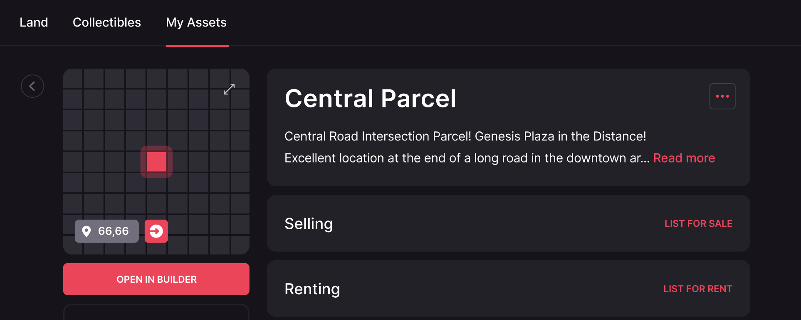

Puedes establecer un precio de alquiler por día en MANA y la cantidad de días que deseas permitir que las personas lo alquilen. El precio por día multiplicado por el número de días en el período es lo que el inquilino pagará **por adelantado y en total** por ese alquiler.

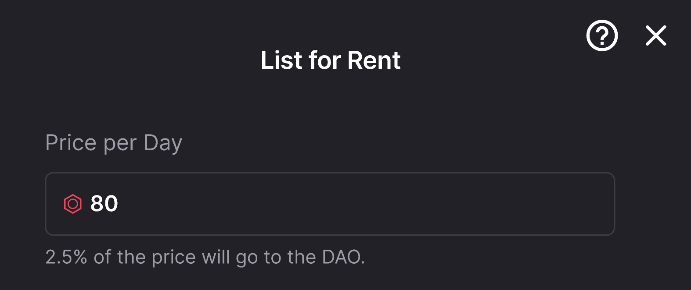

Después de definir el Precio por Día, necesitas seleccionar el número de días que los Usuarios pueden alquilar tu LAND. Por ejemplo, si seleccionas 7 y 30 días solamente, el Inquilino solo puede elegir entre esas 2 opciones. En caso de que se seleccione la opción de 30 días por el Inquilino, esa sería la duración del alquiler desde el día en que se confirme.

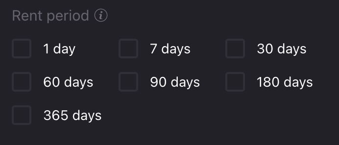

También puedes establecer una fecha de vencimiento para el listado. Esto significa que, si el LAND no fue alquilado hasta la fecha seleccionada, el listado será eliminado del Marketplace. Además, el contrato inteligente rechazará la firma vencida para que nadie pueda alquilarlo por el precio y duración de listado previamente seleccionados. Esta es una medida de seguridad para evitar que se alquile por un precio o duración no deseados.

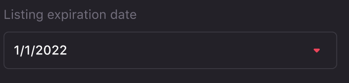

Después de establecer el precio, período de alquiler y fecha de vencimiento del listado, tu LAND aparecerá como disponible para alquiler en el Marketplace.


💡 Cuando LAND es alquilado por un Inquilino, no se puede vender hasta que sea reclamado de vuelta. Tampoco se pueden recibir ofertas de compradores potenciales.



💡 El Poder de Voto lo mantiene el Propietario de LAND, incluso si está alquilado.


### Editar o Cancelar un Listado

Después de que el LAND es Listado para Alquiler en el Marketplace, y antes de que alguien lo alquile, puedes editar las condiciones del Listado haciendo clic en el ícono de lápiz en el detalle del LAND. También puedes eliminar el Listado del Marketplace y de la blockchain.

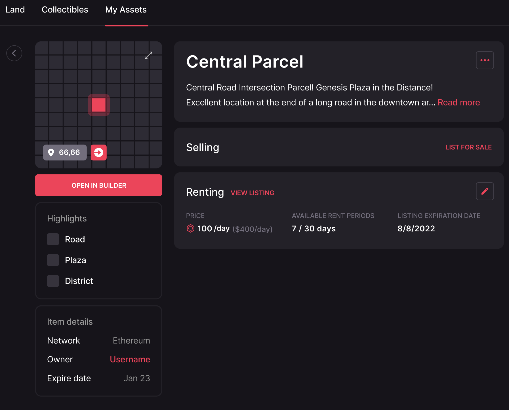


💡 Editar y cancelar requieren una transacción, que cuesta gas. Consulta la sección de Transacciones a continuación para más detalles.


### Después de que el Alquiler ha terminado

Después de que el Alquiler ha terminado, puedes **Reclamar tu LAND de Vuelta o Listarlo para Alquiler Nuevamente**.

**Los Permisos de Operador no se transfieren automáticamente de vuelta al Propietario de LAND**. Para recuperarlos, el Propietario de LAND tiene que Reclamar el LAND de vuelta enviando esa transacción y pagando la tarifa de gas. Confirmar la transacción quitará los Permisos de Operador del Inquilino y los devolverá al Propietario de LAND.

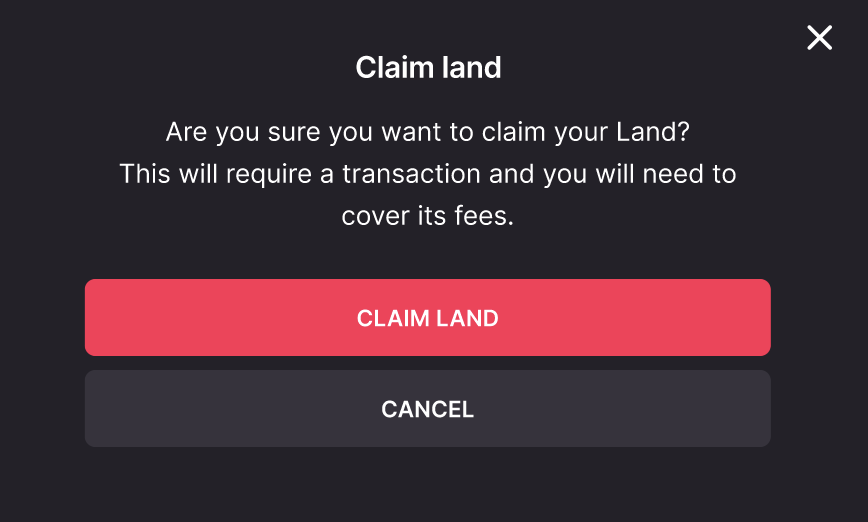

La otra posibilidad es Listar el LAND para Alquiler Nuevamente, en lugar de reclamarlo de vuelta. Esto no requerirá pagar por otra transacción, pero **los Permisos de Operador serán mantenidos por el Inquilino anterior hasta que un nuevo Inquilino confirme un nuevo Alquiler.**

El Propietario de LAND puede editar el precio, período de alquiler y fecha de vencimiento del listado para el nuevo listado.

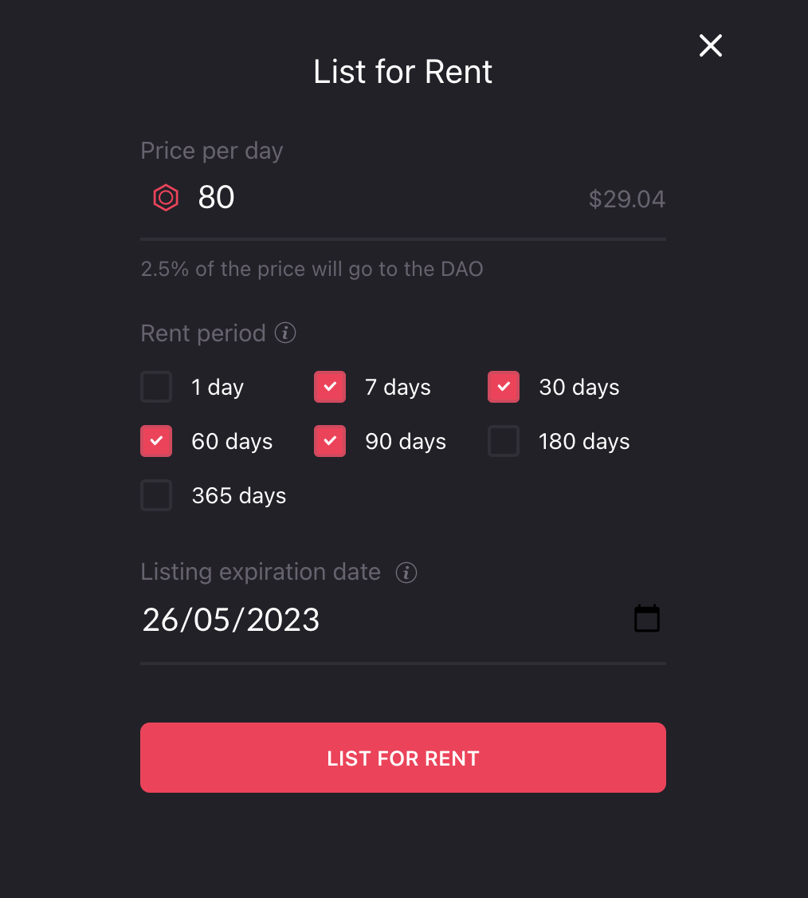

Ambas acciones se pueden hacer desde la página de detalles del LAND en el Marketplace.

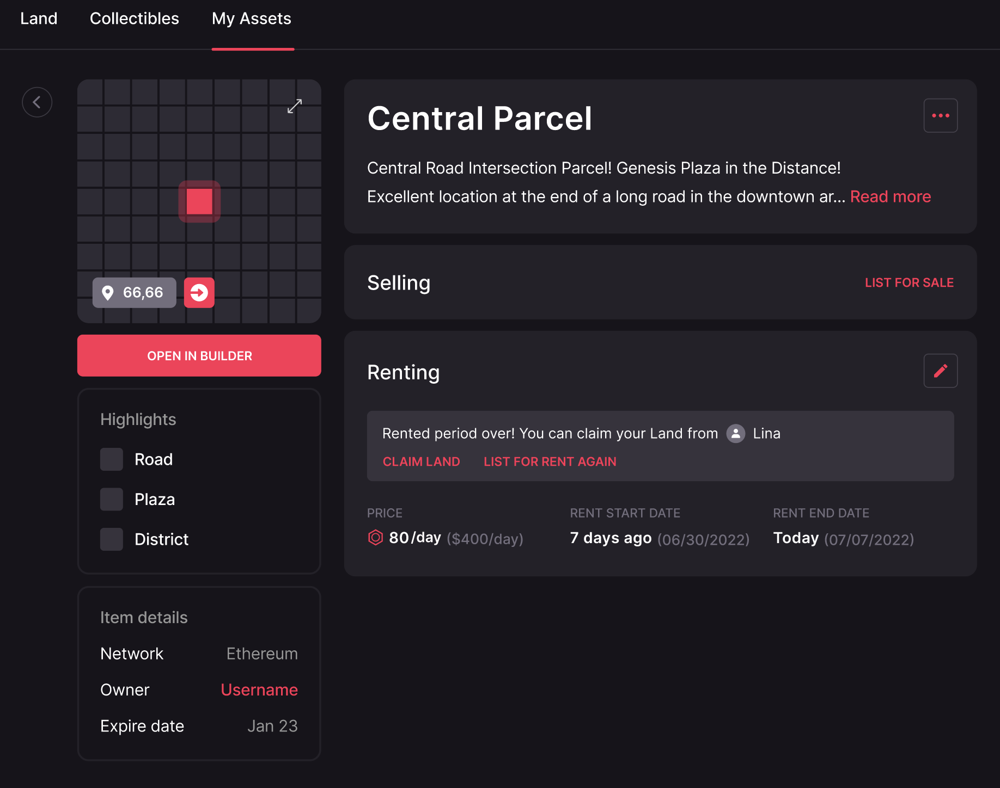

### Estado de Alquiler

Puedes verificar el Estado de cualquier LAND alquilado en Mis Activos > Tienda > En Alquiler. Los estados posibles son:

* Listado para Alquiler - El listado fue confirmado y está disponible para que los usuarios lo alquilen en el Marketplace
* Período de Alquiler Terminado - En esta etapa, el LAND está disponible para Reclamar de Vuelta o Listar Nuevamente para Alquiler por el Propietario de LAND
* Alquilado hasta _"fecha"_ - El LAND ya está alquilado y el Inquilino tiene Permisos de Operador hasta que sea reclamado de vuelta o alquilado por otro usuario

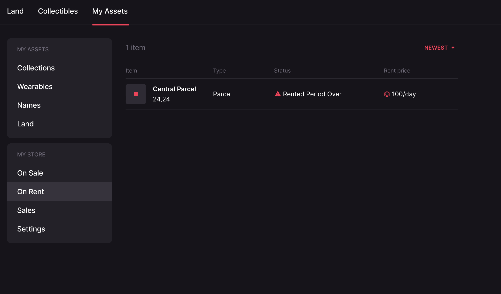

## Para Inquilinos

### Alquilar LAND

Todos los usuarios pueden encontrar LAND listado para alquiler en el Marketplace bajo la sección LAND.

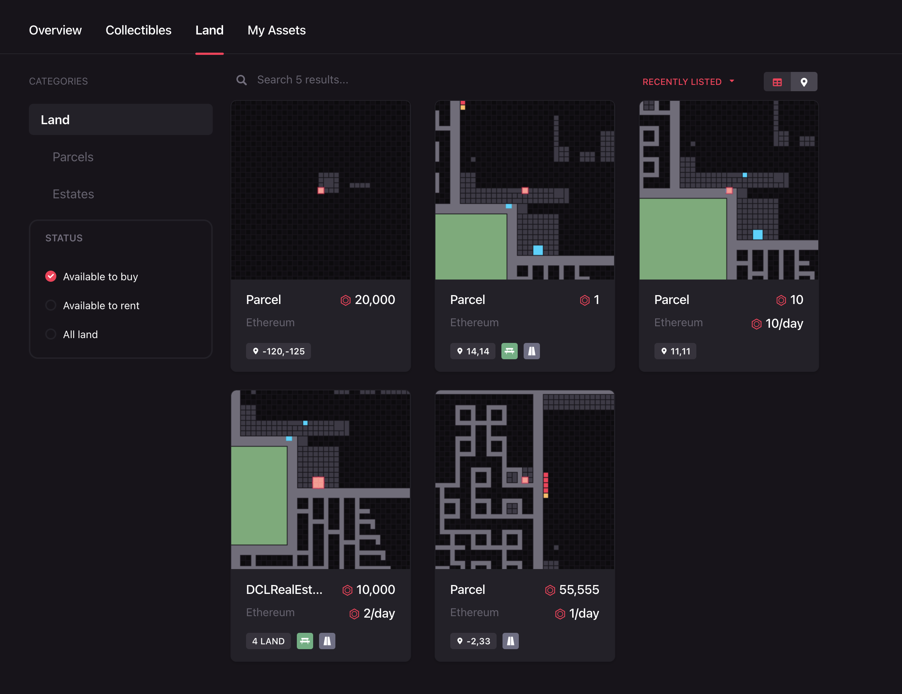

Hay LANDs que están disponibles para Venta o Alquiler. En caso de que ambas opciones estén disponibles, puedes ver las condiciones disponibles para cada una haciendo clic en el interruptor Venta/Alquiler.

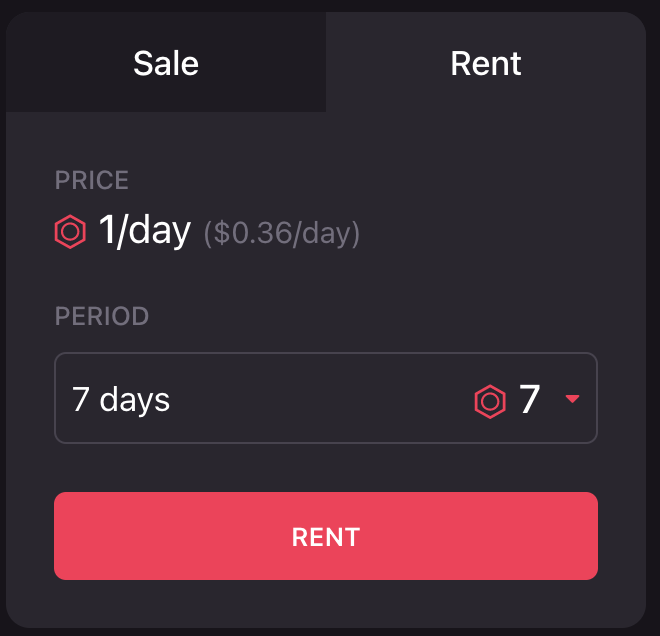

Una vez que encuentres el LAND que quieres alquilar, necesitas seleccionar el Período de Alquiler, estos son los días que tendrás el LAND. Después de seleccionar el Período de Alquiler, verás el precio total a pagar por el Alquiler.

Necesitarás aprobar el Contrato Inteligente de Alquiler para tomar el MANA de tu cuenta antes de proceder.

Antes de confirmar el Alquiler, puedes decidir quién gestionará el LAND (Permiso de Operador). Puede ser tú mismo o cualquier otra dirección que elijas.

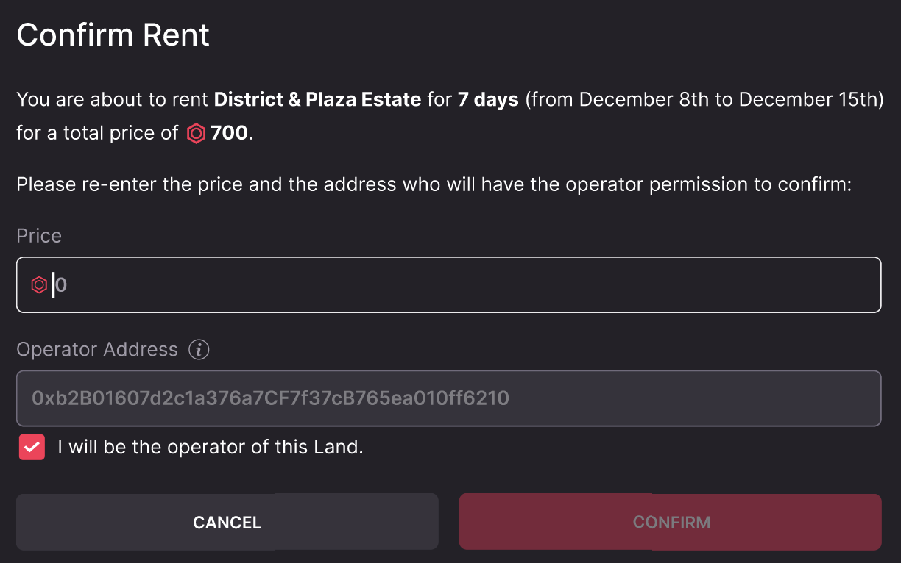

El Permiso de Operador puede ser cambiado más tarde por el Inquilino (la dirección que alquiló el LAND en primer lugar) desde el [Builder](https://builder.decentraland.org/).

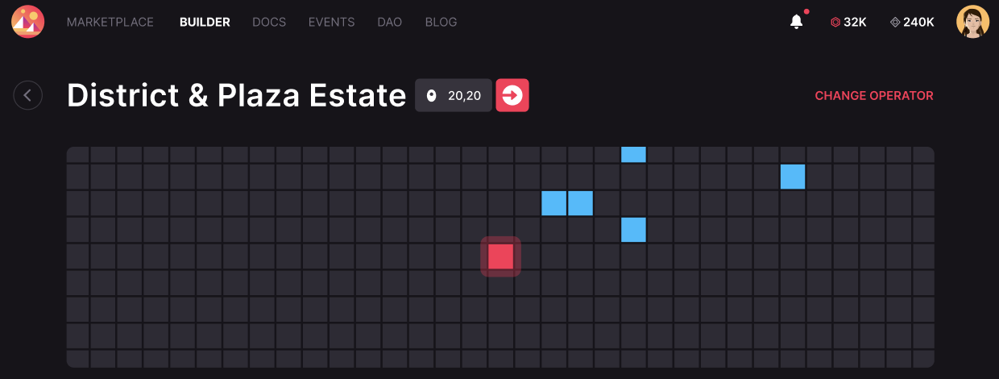

Después de seleccionar todos los detalles y aprobar el Contrato Inteligente de Alquiler para manejar tu MANA, puedes confirmar el Alquiler enviando una transacción.

¡Y ya está todo listo! puedes comenzar a trabajar en tu LAND y desplegar una escena usando el Builder o el SDK.

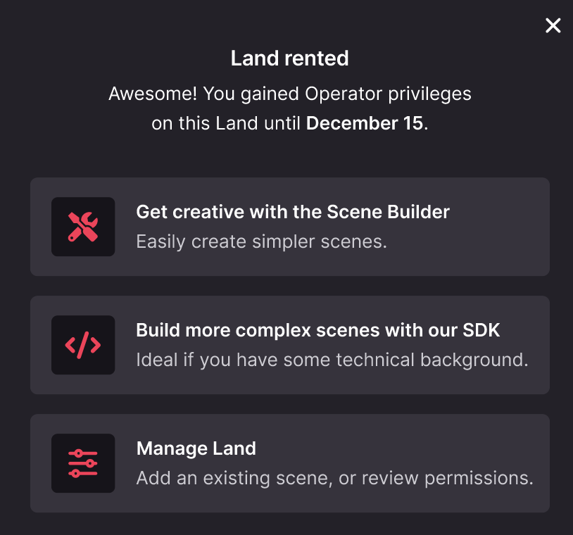

Nota: después de que el Alquiler termine, el Inquilino aún tendrá Permisos de Operador hasta que el Propietario de LAND lo Reclame de vuelta, o alguien más lo alquile. **Asegúrate de guardar tu contenido antes del final del alquiler, de lo contrario podría perderse.**


💡 Alquilar LAND no transfiere Poder de Voto al Inquilino. El Poder de Voto lo mantiene el Propietario de LAND como lo define el DAO en esta [Propuesta](https://governance.decentraland.org/proposal/?id=c98bd010-74b1-11ed-a9bf-f772a12a0556)


## Transacciones

Por el bien de la **seguridad y descentralización**, el sistema de Alquiler se basa en la blockchain de Ethereum como fuente de verdad.

Pero, no todas las acciones involucradas requieren una entrada en la blockchain. Si ese fuera el caso, sería demasiado costoso para ambas partes.

Las transacciones en la blockchain son mínimas para proporcionar un **sistema robusto y sin confianza para el alquiler de LAND mientras se mantiene asequible.** Estas son todas las transacciones a considerar:

### Para Propietarios de Land

#### Listar para Alquiler

Antes de Listar la primera Parcela o Estate para alquiler, los Propietarios de LAND necesitan permitir que el Contrato Inteligente de Alquileres opere LAND en su nombre. Esto tiene que hacerse solo una vez para Parcelas y solo una vez para Estates.

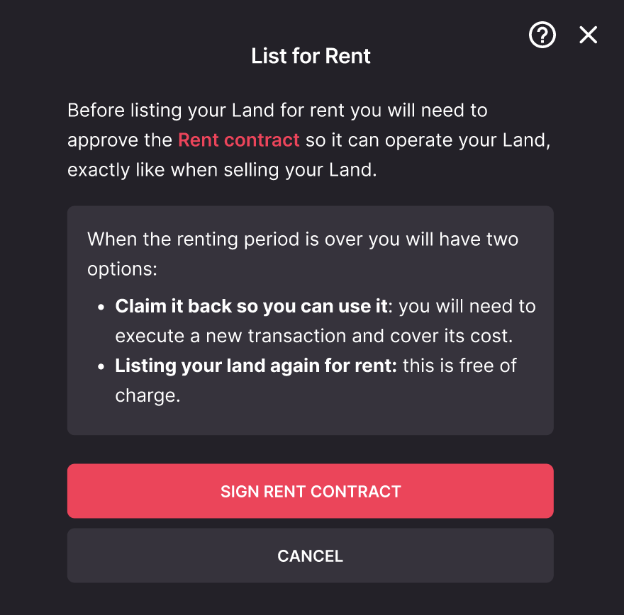

#### Reclamar LAND de Vuelta o Listar para Alquiler Nuevamente

Después de que el período de alquiler termina, **los Permisos de Operador no se transfieren automáticamente de vuelta al Propietario de LAND**. Para recuperarlos, el Propietario de LAND tiene que Reclamar el LAND de vuelta enviando esa transacción y pagando la tarifa de gas.

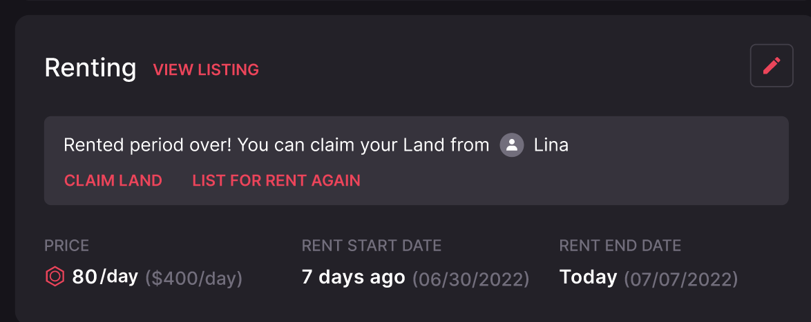

Otra posibilidad es Listar el LAND para Alquiler Nuevamente, en lugar de reclamarlo de vuelta. Esto no requerirá pagar por otra transacción, pero los Permisos de Operador serán mantenidos por el Inquilino anterior hasta que un nuevo Inquilino confirme un nuevo Alquiler.

#### Editar Listado

Si se cambia el Precio, Período de Alquiler o Fecha de Vencimiento, el Propietario de LAND debe enviar una transacción para protegerse de que alguien use la firma del listado anterior en el Contrato Inteligente directamente (no desde la interfaz del Marketplace) y obtenerlo por un precio más bajo del deseado o por una duración no deseada.

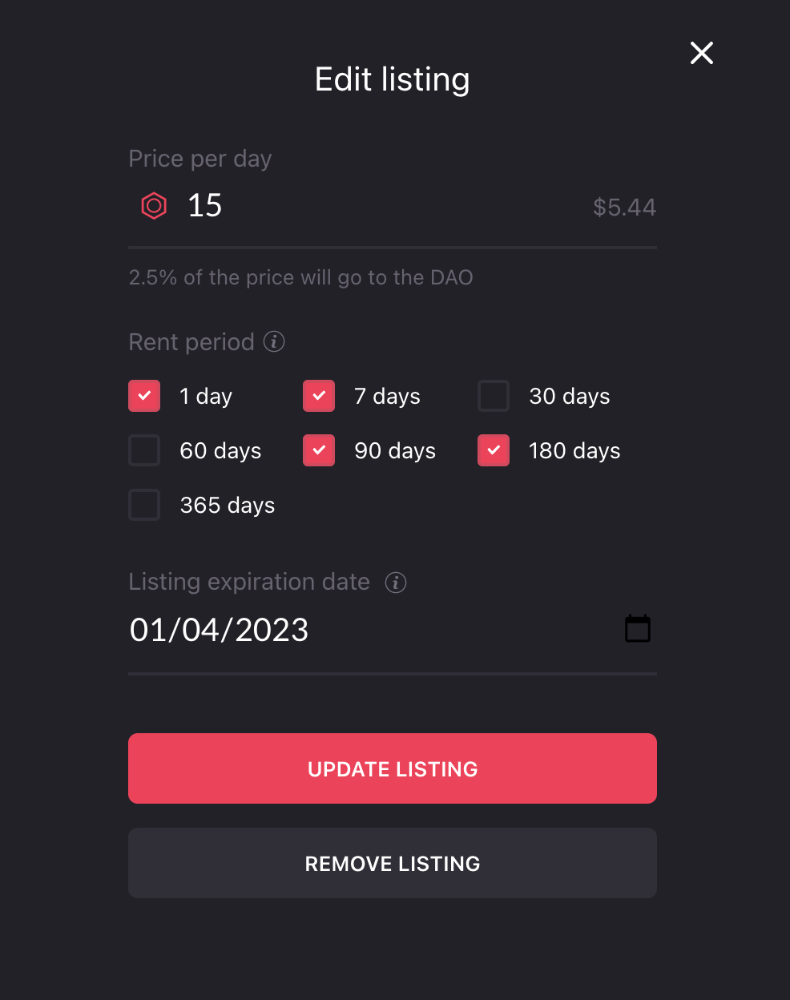

### Para Inquilinos

#### Permitir que el Contrato de Alquiler opere tu MANA

Ya sea una Parcela o un Estate, cada usuario que quiera Alquilar LAND tiene que enviar una transacción para permitir que el Contrato Inteligente de Alquiler opere MANA en su nombre. Esto es necesario porque el Contrato Inteligente tiene que retirar el MANA y transferirlo al Propietario de LAND cuando el alquiler se activa. Esto se hace solo una vez para todos los LAND que se alquilarán desde ese momento en adelante.

#### Alquilar LAND

Después de aprobar el Contrato Inteligente de Alquiler para operar tu MANA, estás listo para confirmar tu primer Alquiler. Una vez que encuentres el LAND que deseas, elige el período de alquiler y confirma la transacción de Alquiler, los Permisos de Operador se transfieren a la dirección seleccionada.

Si quieres alquilar otra Parcela o Estate, solo necesitas enviar una transacción para confirmarlo, no hay necesidad de aprobar el Contrato Inteligente para operar tu MANA nuevamente.

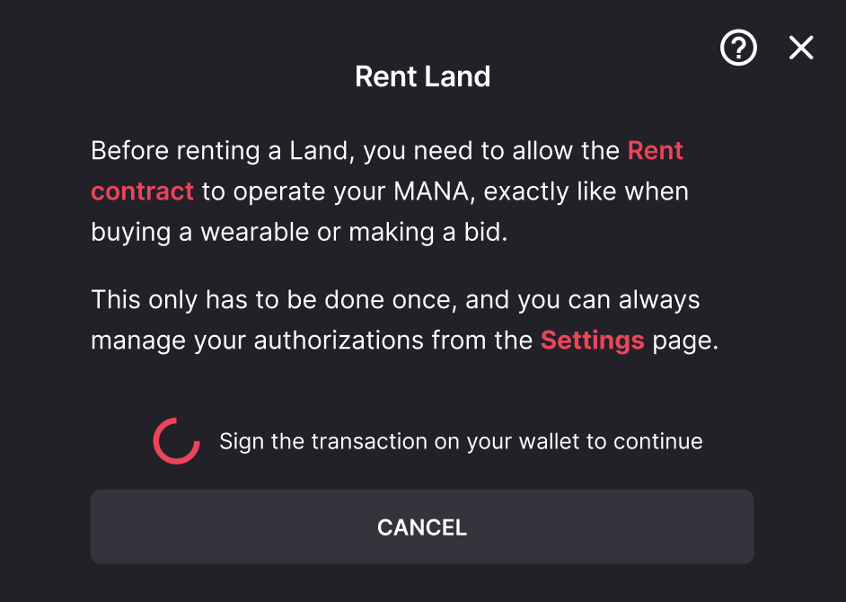

#### Cambiar Operador

En el momento de alquilar el LAND, el usuario puede elegir qué dirección tendrá Permisos de Operador para ese LAND. Si esa dirección quiere ser cambiada, se debe enviar una transacción.

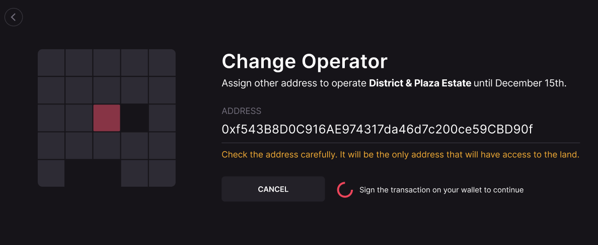

## Billeteras de Contratos Inteligentes

La función de Alquileres depende en gran medida de firmas fuera de la cadena. Las acciones fuera de la cadena permiten a los Propietarios de Land listar LANDs para alquiler sin pagar el costo de la transacción.

Al firmar un listado, el Contrato Inteligente de Alquiler puede verificar que el listado fue creado por el firmante.

La firma tiene la particularidad de que requiere una clave privada. Todas las EOA (Cuentas de Propiedad Externa) tienen una, y pueden firmar listados con ella. El Contrato Inteligente de Alquileres luego verificará la firma generada por la EOA al ejecutar un alquiler.

Las Billeteras de Contratos Inteligentes, que son Contratos Inteligentes, no tienen una clave privada, por lo tanto, no pueden firmar mensajes. En su lugar, una EOA autorizada por la Billetera de Contrato Inteligente tiene que firmar.

Para admitir estas firmas, el Contrato Inteligente de Alquiler verifica con la Billetera de Contrato Inteligente si la firma es válida siguiendo el estándar [EIP-1271](https://eips.ethereum.org/EIPS/eip-1271). Si la firma es válida, el alquiler puede ejecutarse.

La Billetera de Contrato Inteligente no solo tiene que tener el método de verificación de firma estándar definido en el EIP-1271, sino también el método receptor de token definido en el [estándar EIP-721](https://eips.ethereum.org/EIPS/eip-721). Esto es necesario al reclamar LAND de vuelta porque el Contrato Inteligente de Alquiler llamará a un `safeTransferFrom` para devolver el NFT a la Billetera de Contrato Inteligente, y si no ha implementado la función `onERC721Received` apropiada, fallará en recuperar el LAND.
