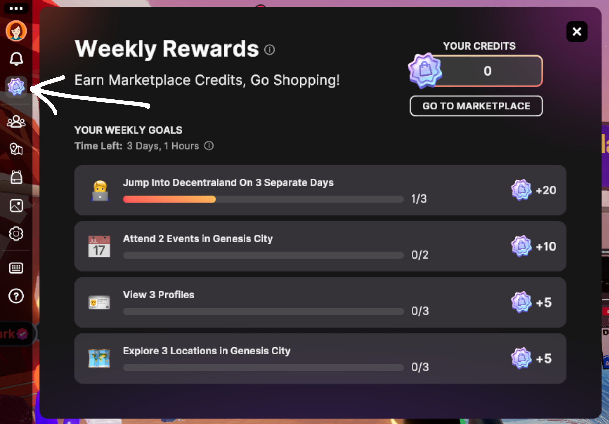
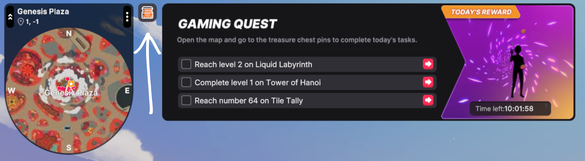
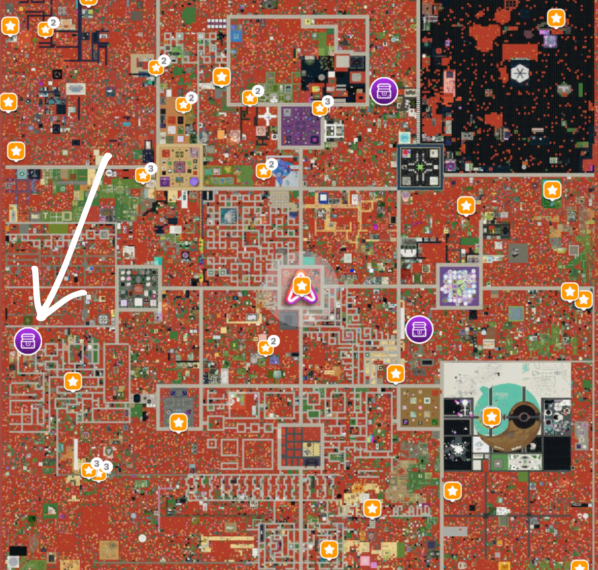

# Earning Rewards

Exploring Decentraland, you never know what you'll find—sometimes treasure in the form of Wearable and Emote giveaways! But those can depend on the particular scene or if a special event is happening.

If you're on the hunt for _guaranteed goodies_, look no farther than Decentraland's Weekly Marketplace Credit Rewards and the multi-day Gaming Quest.

## Weekly Marketplace Credits Rewards

Marketplace Credits can be used to buy Wearables, Emotes and NAMEs without spending any MANA. While a Credits season is active, anyone can earn Credits in exchange for completing weekly goals, such as jumping into Decentraland regularly and attending events. Earned Credits are worth 1 MANA each and expire when the season ends. Seasons aren't always running.

When a season is active, click on the Marketplace Credits icon in the sidebar menu to open your Weekly Rewards interface. There you can track your progress towards your weekly goals and your Credit balance. Learn more about Marketplace Credits [here](https://decentraland.org/blog/announcements/marketplace-credits-earn-weekly-rewards-to-power-up-your-look).

You can also buy Credit packs with a card at any time. Purchased Credits are worth $0.10 each and never expire. See [Paying and Getting Paid](../blockchain-integration/paying-and-getting-paid.md#marketplace-credits).

## Gaming Quest

If you're looking for a challenge that comes with great rewards, the Gaming Quest is for you! You can access it at anytime by clicking on the treasure chest icon to the right of the Mini Map.

Currently, the Quest comprises 25 days of gaming challenges, each with its own Wearable or Emote prize. If you open the map, you'll see purple treasure chest icons marking the locations of the current day's Gaming Quest challenges—you can also teleport directly to the challenge locations by clicking on the red arrows next to each task. Once you complete all the challenges for the current day, that day's prize will be sent to your Backpack!

